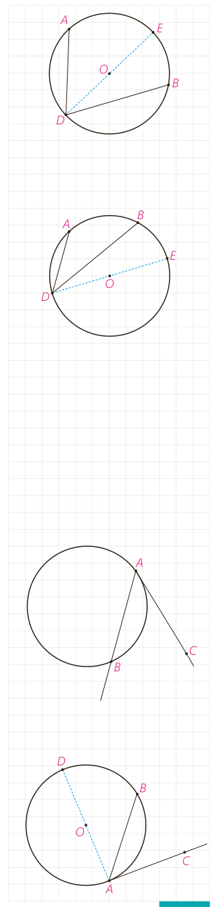

۲- در این شکل $\angle ADB$ یک زاویۀ محاطی است که دو ضلع آن در دو طرف $O$ واقع شده‌اند.

- اگر قطر $DE$ را رسم کنیم، طبق قسمت ۱ داریم:

$$\left.\begin{aligned}\angle ADE&=\frac12\widehat{\ldots}\\\angle EDB&=\frac12\widehat{\ldots}\end{aligned}\right\}\Rightarrow\angle ADB=\frac12\widehat{\ldots}$$

۳- در این شکل $\angle ADB$ یک زاویۀ محاطی است که دو ضلع آن در یک طرف $O$ واقع شده‌اند.

- اگر قطر $DE$ را رسم کنیم، طبق قسمت ۱ داریم:

$$\left.\begin{aligned}\angle ADE&=\frac12\widehat{\ldots}\\\angle BDE&=\frac12\widehat{\ldots}\end{aligned}\right\}\Rightarrow\angle ADB=\frac12\widehat{\ldots}$$

بنابراین:

**قضیه:** اندازۀ هر زاویۀ محاطی برابر است با نصف اندازۀ کمان مقابل به آن زاویه.

## زاویۀ ظلی

نوع دیگری از زاویه، که در دایره مطرح است، زاویۀ ظلی است. زاویۀ ظلی زاویه‌ای است که رأس آن روی دایره قرار دارد و یکی از اضلاع آن مماس بر دایره و ضلع دیگر آن شامل وتری از دایره باشد. در شکل مقابل $\angle BAC$ یک زاویۀ ظلی است.

## فعالیت

۱- زاویۀ ظلی $\angle CAB$ را درنظر بگیرید و قطری از دایره را رسم کنید که شامل نقطۀ $A$ هست.

الف) $\angle DAC=\ldots^\circ$ و بنابراین: $\angle DAC=\frac12\widehat{\ldots}$

ب) زاویۀ $DAB$ یک زاویۀ محاطی است. بنابراین: $\angle DAB=\frac12\widehat{\ldots}$

