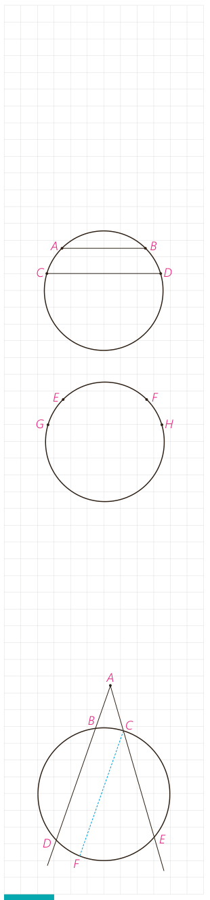

پ) از (الف) و (ب) داریم:

$$\angle DAC-\angle DAB=\frac12(\widehat{\ldots}-\widehat{\ldots})$$

و بنابراین $\angle BAC=\frac12\widehat{\ldots}$

ت) نشان دهید نتیجه قسمت (پ) برای یک زاویۀ ظلی منفرجه نیز برقرار است.

بنابراین:

**قضیه:** اندازۀ هر زاویۀ ظلی برابر است با ............ کمان روبه‌رو به آن زاویه.

## کار در کلاس

۱- در شکل مقابل وترهای $AB$ و $CD$ موازی هستند.

الف) از $A$ به $D$ وصل کنید. زوایای $BAD$ و $ADC$ نسبت به هم چگونه‌اند؟ چرا؟

ب) کمان‌های $\widehat{BD}$ و $\widehat{AC}$ نسبت به هم چگونه‌اند؟ چرا؟

۲- در شکل مقابل کمان‌های $EG$ و $FH$ هم‌اندازه‌اند.

الف) وترهای $EF$ و $GH$ و پاره‌خط $EH$ را رسم کنید.

ب) زوایای $FEH$ و $EHG$ نسبت به هم چگونه‌اند؟ چرا؟

پ) وترهای $EF$ و $GH$ نسبت به هم چگونه‌اند؟ چرا؟

**نتیجه:** دو وتر که یکدیگر را درون دایره قطع نمی‌کنند با هم موازی‌اند، اگر و تنها اگر کمان‌های محدود بین آنها مساوی باشد.

تاکنون زاویه‌هایی را بررسی کردیم که رأس آنها روی دایره باشد و رابطۀ اندازۀ این زاویه‌ها را با اندازۀ کمان‌های ایجاد شده توسط آنها مشخص کردیم. حال به بررسی این موضوع برای زاویه‌هایی می‌پردازیم که رأس آنها درون یا بیرون دایره است و اضلاعشان کمان‌هایی روی دایره جدا می‌کنند.

## فعالیت

۱- فرض کنید رأس زاویۀ $DAE$ مانند شکل مقابل بیرون دایره واقع شده، و کمان‌های $DE$ و $BC$ توسط اضلاع زاویۀ موردنظر مشخص شده باشند.

الف) از نقطۀ $C$ خطی موازی خط $BD$ رسم کنید تا دایره را در نقطه‌ای مانند $F$ قطع کند. علت هرکدام از تساوی‌های زیر را مشخص کنید.

$$\angle DAE=\angle FCE=\frac12\widehat{FE}=\frac12(\widehat{DE}-\widehat{DF})=\frac12(\widehat{DE}-\widehat{BC})$$

