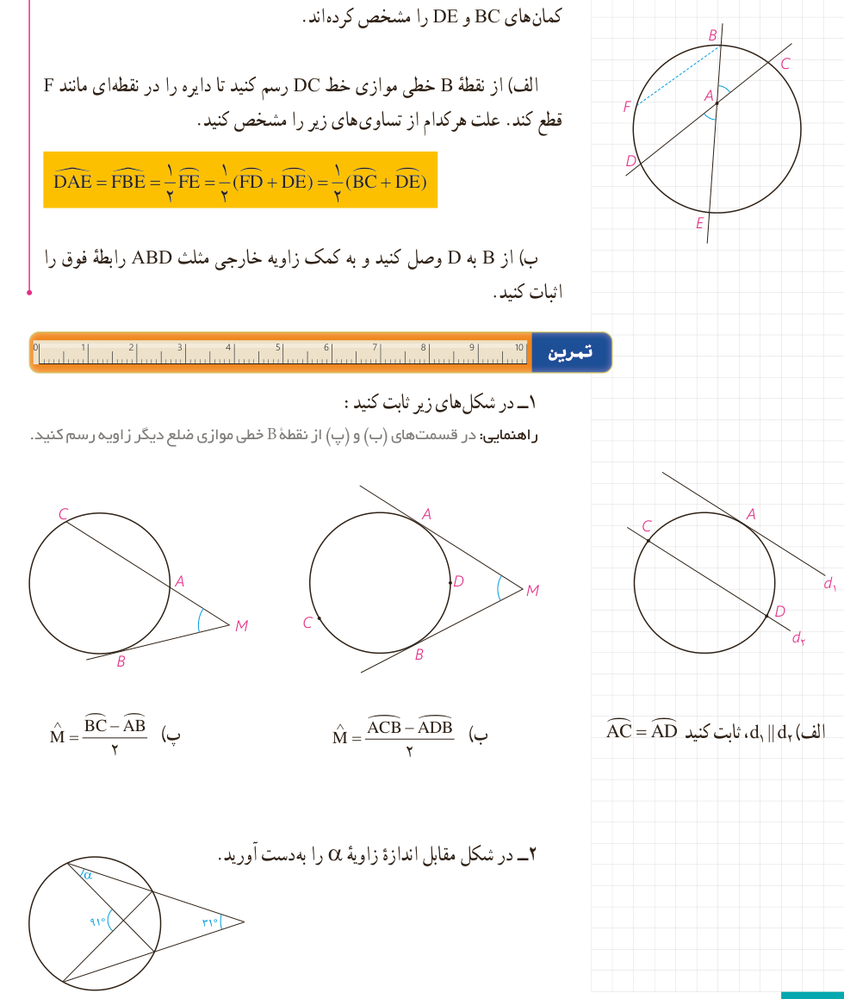

ب) از $C$ به $D$ وصل کنید و به کمک زاویۀ خارجی در مثلث $ACD$ رابطۀ فوق را اثبات کنید.

۲- رأس زاویۀ $DAE$ مانند شکل در درون دایره است و اضلاع این زاویه کمان‌های $BC$ و $DE$ را مشخص کرده‌اند.

الف) از نقطۀ $B$ خطی موازی خط $DC$ رسم کنید تا دایره را در نقطه‌ای مانند $F$ قطع کند. علت هرکدام از تساوی‌های زیر را مشخص کنید.

$$\angle DAE=\angle FBE=\frac12\widehat{FE}=\frac12(\widehat{FD}+\widehat{DE})=\frac12(\widehat{BC}+\widehat{DE})$$

ب) از $B$ به $D$ وصل کنید و به کمک زاویۀ خارجی مثلث $ABD$ رابطۀ فوق را اثبات کنید.

## تمرین

۱- در شکل‌های زیر ثابت کنید:

راهنمایی: در قسمت‌های (ب) و (پ) از نقطۀ $B$ خطی موازی ضلع دیگر زاویه رسم کنید.

الف) $d_1\parallel d_2$، ثابت کنید $\widehat{AC}=\widehat{AD}$

ب) $\angle M=\frac{\widehat{ACB}-\widehat{ADB}}2$

پ) $\angle M=\frac{\widehat{BC}-\widehat{AB}}2$

۲- در شکل مقابل اندازۀ زاویۀ $\alpha$ را به‌دست آورید.

