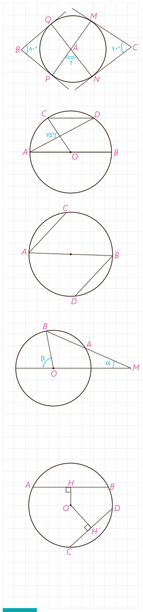

۳- در شکل اضلاع زاویه‌های $B$ و $C$ بر دایره مماس‌اند. اندازۀ زاویۀ $\widehat A$ چند درجه است؟

۴- در دایرۀ رسم شده شکل مقابل $AB\parallel CD$، اندازۀ کمان $CD$ را به‌دست آورید.

۵- در شکل مقابل، $AB$ قطری از دایره است و وترهای $AC$ و $BD$ موازی‌اند. ثابت کنید: $AC=BD$.

۶- دایرۀ $C(O,R)$ مفروض است. از نقطۀ $M$ در خارج دایره خطی چنان رسم کرده‌ایم که دایره را در دو نقطۀ $A$ و $B$ قطع کرده است و $MA=R$؛ نشان دهید: $\beta=3\alpha$.

۷- در دایرۀ $C(O,R)$، $\widehat{AB}=60^\circ$ و $AB=10$ فاصلۀ $O$ از وتر $AB$ را به دست آورید.

۸- در دایرۀ $C(O,R)$ نشان دهید $AB>CD$ اگر و تنها اگر $OH<OH'$ ($OH$ و $OH'$ فاصله $O$ از دو وتر $AB$ و $CD$ هستند.)

راهنمایی: از $O$ به $B$ و $C$ وصل، و از قضیۀ فیثاغورس استفاده کنید.

