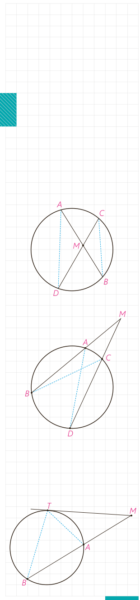

# درس دوم: رابطه‌های طولی در دایره

اگر خط‌های شامل دو وتر از یک دایره، یکدیگر را در درون یا بیرون دایره قطع کنند بین اندازۀ پاره‌خط‌های حاصل روابطی داریم که به بررسی آنها می‌پردازیم.

## فعالیت

۱- دو وتر $AB$ و $CD$ در نقطۀ $M$ در داخل دایره یکدیگر را قطع کرده‌اند.

الف) از $A$ به $D$ و از $C$ به $B$ وصل کنید و نشان دهید دو مثلث $MAD$ و $MBC$ متشابه‌اند.

ب) با توجه به تشابه این دو مثلث داریم: $\frac{AM}{CM}=\frac{DM}{\ldots}$

و در نتیجه: $AM\cdot\ldots=CM\cdot\ldots$

۲- خط‌های شامل دو وتر $AB$ و $CD$ در نقطۀ $M$ در خارج دایره یکدیگر را قطع کرده‌اند.

الف) نقطۀ $A$ را به $D$ و نقطۀ $C$ را به $B$ وصل کنید و نشان دهید دو مثلث $MAD$ و $MCB$ باهم متشابه‌اند.

ب) با توجه به این تشابه داریم: $\frac{MA}{MC}=\frac{MD}{\ldots}$

و در نتیجه: $MA\cdot\ldots=MC\cdot\ldots$

**قضیه:** هرگاه خط‌های شامل دو وتر دلخواه $AB$ و $CD$ در نقطه‌ای مانند $M$ (درون یا بیرون دایره) یکدیگر را قطع کنند، آن‌گاه: $MA\cdot MB=MC\cdot MD$.

۳- فرض کنیم از نقطۀ $M$ (خارج دایره) مانند شکل یک مماس و یک قاطع بر دایره رسم کرده‌ایم.

الف) $T$ را به $A$ و $B$ وصل، و مشخص کنید چرا؟ $\angle MTA=\angle TBM$

