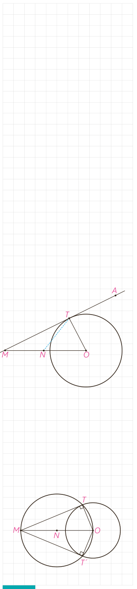

ب) علت تشابه دو مثلث $MAT$ و $MTB$ را مشخص، و با توجه به این تشابه رابطۀ زیر را کامل کنید.

$$\frac{MA}{MT}=\frac{MT}{\ldots}$$

و در نتیجه: $MT^2=\ldots\cdot\ldots$

بنابراین قضیۀ زیر را داریم:

**قضیه:** هرگاه $M$ نقطه‌ای بیرون دایره باشد و از $M$ مماس و قاطعی نسبت به دایره رسم کنیم، مربع اندازۀ مماس برابر است با حاصل‌ضرب اندازه‌های دو قطعۀ قاطع.

یعنی طول مماس واسطۀ هندسی بین دو قطعۀ قاطع است.

## رسم مماس بر دایره از نقطه‌ای خارج دایره

اگر خط $d$ در نقطۀ $T$ بر دایره مماس باشد و $A$ و $M$ دو نقطه بر خط $d$ در دو طرف نقطۀ $T$ باشند، هرکدام از پاره‌خط‌های $MT$ و $AT$ بر دایره مماس‌اند.

اگر $O$ مرکز دایره باشد، $\triangle OMT$ در رأس $T$ قائم‌الزاویه است؛ چرا؟

اگر $N$ وسط پاره‌خط $OM$ باشد، $NM=NO=NT$؛ چرا؟

بنابراین دایره به مرکز $N$ و قطر $OM$ از نقطۀ $T$ می‌گذرد.

از این ویژگی می‌توانیم در رسم مماس بر دایره از نقطۀ $M$ خارج دایره بر آن استفاده کنیم.

پس برای رسم مماس بر دایره از نقطۀ $M$ خارج دایره، ابتدا دایره‌ای به قطر $OM$ ($O$ مرکز دایره) رسم می‌کنیم.

این دایره، دایرۀ مفروض را در دو نقطۀ $T$ و $T'$ قطع می‌کند. خط‌های $MT$ و $MT'$ بر دایره مماس‌اند؛ چرا؟

