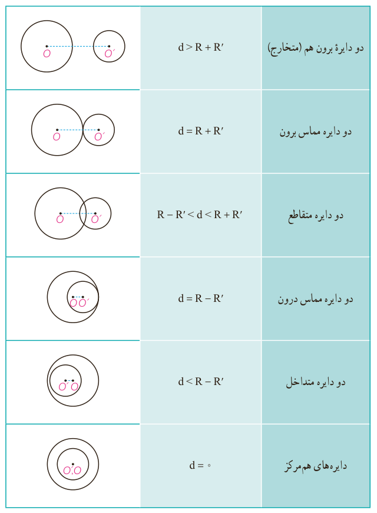

## کار در کلاس

هرگاه از نقطۀ $M$ خارج دایرۀ $C(O,R)$ دو مماس بر دایره رسم کنیم و $T$ و $T'$ نقاط تماس باشند، ثابت کنید:

الف) اندازه‌های دو مماس برابرند.

ب) نیم‌خط $MO$ نیمساز زاویۀ $TMT'$ است.

## حالت‌های دو دایره نسبت به هم و مماس مشترک‌ها

دو دایرۀ $C(O,R)$ و $C'(O',R')$ را با فرض $R>R'$ و $OO'=d$ درنظر می‌گیریم. حالت‌های مختلفی که این دو دایره می‌توانند نسبت به هم داشته باشند به‌صورت زیر است:

| وضعیت | رابطه |
|---|---|
| دو دایره بیرون هم (متخارج) | $d>R+R'$ |
| دو دایره مماس برون | $d=R+R'$ |
| دو دایره متقاطع | $R-R'<d<R+R'$ |
| دو دایره مماس درون | $d=R-R'$ |
| دو دایره متداخل | $d<R-R'$ |
| دایره‌های هم‌مرکز | $d=0$ |

