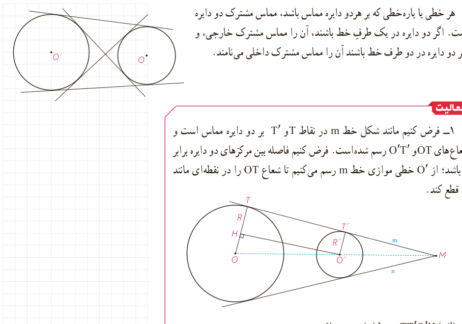

هر خطی یا پاره‌خطی که بر هر دو دایره مماس باشد، مماس مشترک دو دایره است. اگر دو دایره در یک طرف خط باشند، آن را مماس مشترک خارجی، و اگر دو دایره در دو طرف خط باشند آن را مماس مشترک داخلی می‌نامند.

## فعالیت

۱- فرض کنیم مانند شکل خط $m$ در نقاط $T$ و $T'$ بر دو دایره مماس است و شعاع‌های $OT$ و $O'T'$ رسم شده است. فرض کنیم فاصله بین مرکزهای دو دایره برابر $d$ باشد؛ از $O'$ خطی موازی خط $m$ رسم می‌کنیم تا شعاع $OT$ را در نقطه‌ای مانند $H$ قطع کند.

الف) $TT'O'H$ مستطیل است؛ چرا؟

ب) با توجه به قضیۀ فیثاغورس در مثلث $O'HO$، تساوی زیر را توجیه کنید.

$$TT'=\sqrt{d^2-(R-R')^2}$$

پ) با توجه به کار در کلاس قبل بگویید چرا اگر دو مماس مشترک $m$ و $n$ متقاطع باشند، نقطۀ تقاطع آنها روی خط $OO'$ خواهد بود؟

ت) به مرکز $O$ و به شعاع $R-R'$ دایره‌ای رسم کنید. پاره‌خط $O'H$ برای دایرۀ رسم شده چگونه خطی است؟

ث) فرض کنید دو دایره داده شده، و رسم مماس مشترک خواسته شده باشند. از آنجا که مرکزها و شعاع‌های دو دایره معلوم است، می‌توان دایرۀ مطرح شده در قسمت (ت) را رسم کرد و سپس مماس $O'H$ را بر آن رسم کرد؛ در این صورت چگونه می‌توانید مماس $TT'$ را رسم کنید؟

