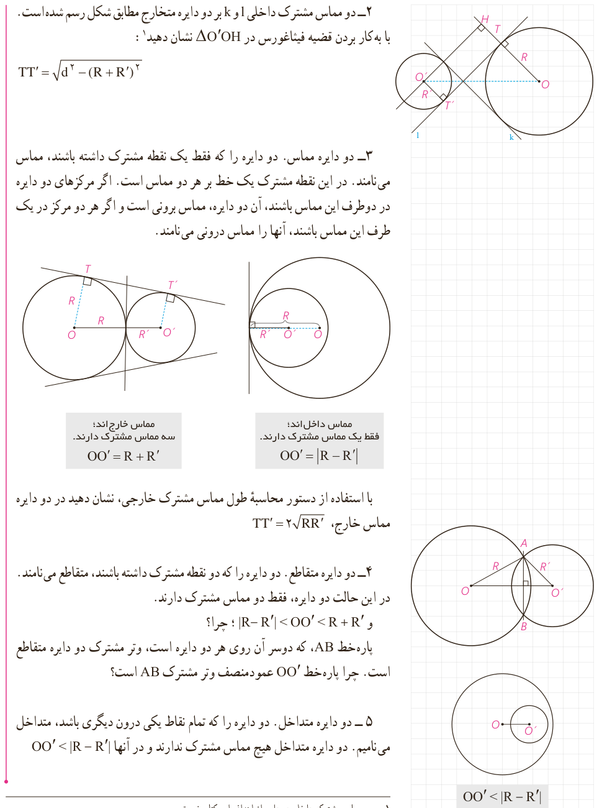

۲- دو مماس مشترک داخلی $l$ و $k$ بر دو دایرۀ متخارج مطابق شکل رسم شده است. با به کار بردن قضیۀ فیثاغورس در $\triangle O'OH$ نشان دهید:¹

$$TT'=\sqrt{d^2-(R+R')^2}$$

۳- دو دایره مماس. دو دایره را که فقط یک نقطۀ مشترک داشته باشند، مماس می‌نامند. در این نقطۀ مشترک یک خط بر هر دو مماس است. اگر مرکزهای دو دایره در دو طرف این مماس باشند، آن دو دایره، مماس بیرونی است و اگر هر دو مرکز در یک طرف این مماس باشند، آنها را مماس درونی می‌نامند.

مماس خارج‌اند: سه مماس مشترک دارند. $OO'=R+R'$

مماس داخل‌اند: فقط یک مماس مشترک دارند. $OO'=|R-R'|$

با استفاده از دستور محاسبۀ طول مماس مشترک خارجی، نشان دهید در دو دایرۀ مماس خارج، $TT'=2\sqrt{RR'}$.

۴- دو دایره متقاطع. دو دایره را که دو نقطۀ مشترک داشته باشند، متقاطع می‌نامند. در این حالت دو دایره، فقط دو مماس مشترک دارند. و $|R-R'|<OO'<R+R'$؛ چرا؟

پاره‌خط $AB$، که دو سر آن روی هر دو دایره است، وتر مشترک دو دایرۀ متقاطع است. چرا پاره‌خط $OO'$ عمودمنصف وتر مشترک $AB$ است؟

۵- دو دایره متداخل. دو دایره را که تمام نقاط یکی درون دیگری باشد، متداخل می‌نامیم. دو دایرۀ متداخل هیچ مماس مشترک ندارند و در آنها $OO'<|R-R'|$.

۱- رسم مماس مشترک داخلی دو دایره از اهداف این کتاب نیست.

