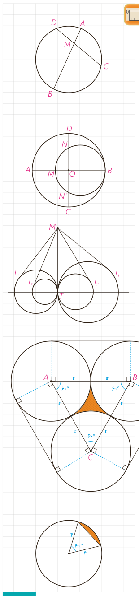

## تمرین

۱- در دایرۀ $C(O,R)$ وتر $AB$، وتر $CD$ به طول ۹ سانتی‌متر را به نسبت ۱ به ۲ تقسیم کرده است. اگر $AB=11\,\mathrm{cm}$، آن‌گاه وتر $CD$ وتر $AB$ را به چه نسبتی قطع می‌کند؟

۲- از نقطۀ $P$ در خارج دایره‌ای، مماس $PA$ به طول $10\sqrt3$ را بر آن رسم کرده‌ایم ($A$ روی دایره است). همچنین خطی از $P$ گذرانده‌ایم که دایره را در دو نقطۀ $B$ و $C$ قطع کرده است و $BC=20$. طول‌های $PB$ و $PC$ را به‌دست آورید.

۳- در شکل مقابل، دو دایره برهم مماس و دو قطر $AB$ و $CD$ از دایرۀ بزرگ‌تر برهم عمودند. اگر $AM=16$ و $ND=10$، شعاع‌های دو دایره را پیدا کنید.

۴- مطابق شکل مقابل، تمام دایره‌ها در نقطۀ $T$ برهم مماس‌اند و از نقطۀ $M$ روی مماس مشترک آنها بر دایره‌ها مماس رسم کرده‌ایم؛ ثابت کنید:

$$MT_1=MT_2=MT_3=MT_4=\cdots$$

۵- طول شعاع‌های دو دایرۀ متخارج را به‌دست آورید که طول مماس مشترک خارجی آنها مساوی $3\sqrt7$ و طول مماس مشترک داخلی آنها $\sqrt{15}$ و طول خط‌المرکزین آنها مساوی ۸ واحد است.

۶- سه دایره به شعاع‌های برابر $r$ دو به دو برهم مماس‌اند. مطابق شکل مقابل این سه دایره به وسیلۀ نخی بسته شده‌اند. نشان دهید طول این نخ برابر $6r+2\pi r$ و همچنین نشان دهید مساحت ناحیۀ محدود به سه دایره برابر $r^2(\sqrt3-\frac\pi2)$ است.

۷- طول خط‌المرکزین دو دایرۀ مماس درونی ۲ سانتی‌متر و مساحت ناحیۀ محدود بین آنها $16\pi$ سانتی‌مترمربع است. طول شعاع‌های دو دایره را به‌دست آورید.

۸- مطابق شکل دایره به شعاع ۴، مساحت ناحیۀ سایه زده را محاسبه کنید. این ناحیه، یک قطعۀ دایره نام دارد.

