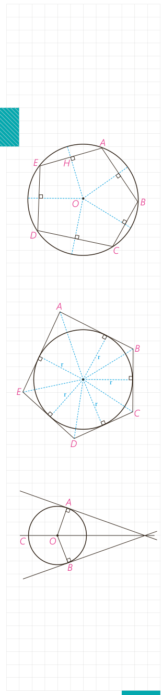

# درس سوم: چند ضلعی‌های محاطی و محیطی

چند ضلعی را محاطی می‌گوییم اگر و فقط اگر دایره‌ای باشد که از همه رئوس آن بگذرد؛ در این صورت دایره را دایرۀ محیطی آن چند ضلعی می‌نامیم.

به‌طور مثال $ABCDE$ یک پنج ضلعی محاطی است.

می‌دانیم برای اینکه دایره‌ای از دو نقطه بگذرد، باید مرکز آن روی عمود منصف پاره‌خطی باشد که آن دو نقطه دو سر آن است؛ بنابراین:

یک چند ضلعی، محاطی است اگر و فقط اگر عمود منصف‌های همه ضلع‌های آن در یک نقطه همرس باشند.

این نقطه مرکز دایرۀ محیطی چند ضلعی است. چرا؟

چند ضلعی را محیطی می‌گوییم اگر و فقط اگر دایره‌ای باشد که بر همۀ ضلع‌های آن مماس باشد؛ در این صورت دایره را دایرۀ محاطی این چند ضلعی می‌نامیم.

## فعالیت

فرض کنید دایرۀ $C$ بر دو ضلع زاویه‌ای مانند شکل مماس باشد.

الف)

۱- پاره‌خط‌هایی که مرکز دایره را به نقاط تماس اضلاع با دایره وصل می‌کند، رسم کنید و آنها را $OA$ و $OB$ بنامید.

۲- پاره‌خط‌های $OA$ و $OB$ برای دایره چه نوع پاره‌خطی هستند؟

۳- فاصلۀ نقطۀ $O$ (مرکز دایره) تا ضلع‌های زاویۀ مفروض با طول پاره‌خط‌های رسم شده ($OA$ و $OB$) چه رابطه‌ای دارد؟

۴- با توجه به (۲) و (۳) فاصلۀ مرکز دایره از دو ضلع زاویه ............... و بنابراین نقطۀ $O$ روی ...............

