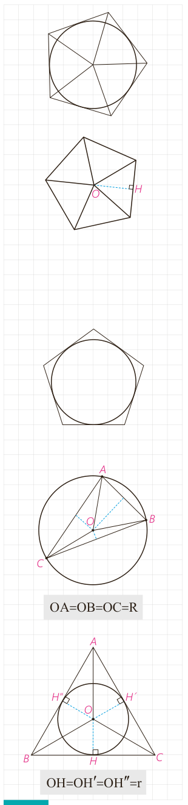

۵- فرض کنید مانند شکل مقابل، دایره در یک چند ضلعی محاط شده باشد. چرا مرکز دایره، محل برخورد نیمسازهای زاویه‌های داخلی چند ضلعی است؟

ب) فرض کنید یک چند ضلعی مانند شکل مقابل به گونه‌ای باشد که نیمسازهای زوایای داخلی آن در نقطۀ $O$ یکدیگر را قطع کرده باشند و $OH$ پاره‌خط عمود به یک ضلع چند ضلعی باشد. دایره‌ای به مرکز $O$ و شعاع $OH$ برای چند ضلعی مفروض چه نوع دایره‌ای است؟ چرا؟

بنابراین: یک چند ضلعی، محیطی است اگر و فقط اگر همه نیمسازهای زاویه‌های آن در یک نقطه همرس باشند. این نقطه مرکز دایرۀ محاطی چند ضلعی است.

## کار در کلاس

اگر در یک $n$ ضلعی محیطی با مساحت $S$ و محیط $2P$ شعاع دایره محاطی برابر $r$ باشد، نشان دهید $S=rp$.

راهنمایی: کافی است مساحت $n$ مثلث را محاسبه، و با هم جمع کنید.

## دایره‌های محیطی و محاطی مثلث

قبلاً همرسی سه عمود منصف یک مثلث را ثابت کرده‌ایم؛ بنابراین نقطۀ همرسی سه عمود منصف مثلث، تنها نقطه‌ای است که از سه رأس یک مثلث به یک فاصله است. پس اگر دایره‌ای به مرکز نقطۀ تلاقی سه عمود منصف و به شعاع فاصلۀ این نقطه تا یک رأس رسم کنیم، این دایره از هر سه رأس مثلث می‌گذرد؛ یعنی دایرۀ محیطی مثلث است. در نتیجه مثلث همواره محاطی است.

همچنین ثابت کرده‌ایم سه نیمساز زاویه‌های داخلی مثلث در نقطه‌ای درون مثلث همرس‌اند. در نتیجه مثلث، محیطی نیز هست. بنابر ویژگی نیمساز، این نقطه از هر سه ضلع مثلث به یک فاصله است.

پس مرکز دایرۀ محاطی مثلث نقطۀ همرسی سه نیمساز است و شعاع این دایره، که آن را با $r$ نشان می‌دهیم، فاصلۀ این نقطه از هر یک از سه ضلع است. بنابر آنچه در مورد $n$ ضلعی‌های محیطی نشان دادیم در مثلث نیز $S=pr$ که $S$ مساحت و $P$ نصف محیط مثلث است.

