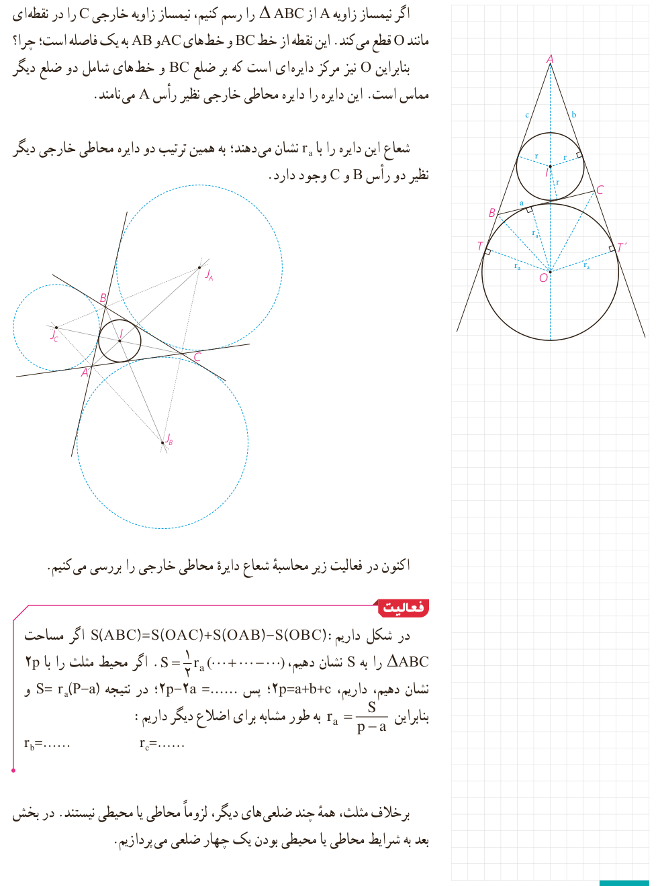

اگر نیمساز زاویۀ $A$ از $\triangle ABC$ را رسم کنیم، نیمساز زاویۀ خارجی $C$ را در نقطه‌ای مانند $O$ قطع می‌کند. این نقطه از خط $BC$ و خط‌های $AC$ و $AB$ به یک فاصله است؛ چرا؟ بنابراین $O$ نیز مرکز دایره‌ای است که بر ضلع $BC$ و خط‌های شامل دو ضلع دیگر مماس است. این دایره را دایرۀ محاطی خارجی نظیر رأس $A$ می‌نامند.

شعاع این دایره را با $r_a$ نشان می‌دهند؛ به همین ترتیب دو دایرۀ محاطی خارجی دیگر نظیر دو رأس $B$ و $C$ وجود دارد.

اکنون در فعالیت زیر محاسبۀ شعاع دایرۀ محاطی خارجی را بررسی می‌کنیم.

## فعالیت

در شکل داریم: $S(ABC)=S(OAC)+S(OAB)-S(OBC)$. اگر مساحت $\triangle ABC$ را به $S$ نشان دهیم، $S=\frac12r_a(\ldots+\ldots-\ldots)$. اگر محیط مثلث را با $2p$ نشان دهیم، داریم، $2p=a+b+c$؛ پس $2p-2a=\ldots$؛ در نتیجه $S=r_a(P-a)$ و بنابراین $r_a=\frac{S}{p-a}$. به طور مشابه برای اضلاع دیگر داریم:

$$r_b=\ldots\qquad r_c=\ldots$$

برخلاف مثلث، همۀ چند ضلعی‌های دیگر، لزوماً محاطی یا محیطی نیستند. در بخش بعد به شرایط محاطی یا محیطی بودن یک چهار ضلعی می‌پردازیم.

