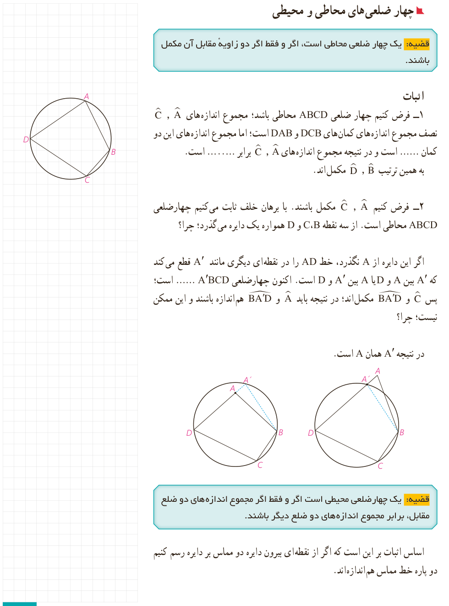

## چهار ضلعی‌های محاطی و محیطی

**قضیه:** یک چهار ضلعی محاطی است، اگر و فقط اگر دو زاویۀ مقابل آن مکمل باشند.

### اثبات

۱- فرض کنیم چهار ضلعی $ABCD$ محاطی باشد؛ مجموع اندازه‌های $\widehat A$، $\widehat C$ نصف مجموع اندازه‌های کمان‌های $DCB$ و $DAB$ است؛ اما مجموع اندازه‌های این دو کمان ...... است و در نتیجه مجموع اندازه‌های $\widehat A$، $\widehat C$ برابر ......... است. به همین ترتیب $\widehat B$، $\widehat D$ مکمل‌اند.

۲- فرض کنیم $\widehat A$، $\widehat C$ مکمل باشند. با برهان خلف ثابت می‌کنیم چهارضلعی $ABCD$ محاطی است. از سه نقطه $B$، $C$ و $D$ همواره یک دایره می‌گذرد؛ چرا؟

اگر این دایره از $A$ نگذرد، خط $AD$ را در نقطه‌ای دیگری مانند $A'$ قطع می‌کند که $A'$ بین $A$ و $D$ یا $A$ بین $A'$ و $D$ است. اکنون چهارضلعی $A'BCD$ ...... است؛ پس $\widehat C$ و $\angle BA'D$ مکمل‌اند؛ در نتیجه باید $\widehat A$ و $\angle BA'D$ هم‌اندازه باشند و این ممکن نیست؛ چرا؟

در نتیجه $A'$ همان $A$ است.

**قضیه:** یک چهارضلعی محیطی است اگر و فقط اگر مجموع اندازه‌های دو ضلع مقابل، برابر مجموع اندازه‌های دو ضلع دیگر باشند.

اساس اثبات بر این است که اگر از نقطه‌ای بیرون دایره دو مماس بر دایره رسم کنیم دو پاره‌خط مماس هم‌اندازه‌اند.

