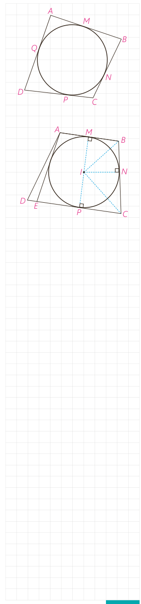

## اثبات

۱- اگر چهارضلعی $ABCD$ محیطی باشد،

$$AB+CD=AM+\ldots+PC+\ldots=AQ+\ldots+CN+\ldots=AD+BC$$

عکس این قضیه نیز با برهان خلف ثابت می‌شود.

۲- فرض کنید: $AB+CD=BC+AD$.

نیمسازهای دو زاویۀ $B$ و $C$ همدیگر را در نقطه‌ای مانند $I$ قطع می‌کنند. با توجه به ویژگی نیمساز، چرا نقطۀ $I$ از سه ضلع $CD$ و $BC$ و $AB$ به یک فاصله است؟ ($IM=IN=IP$) چرا دایره‌ای به مرکز $I$ و شعاع $IM$ بر $AB$ و $BC$ و $CD$ مماس است؟ حال اگر این دایره بر $AD$ هم مماس باشد، حکم ثابت شده است.

اما اگر این دایره بر $AD$ مماس نباشد از $A$ بر آن مماسی رسم می‌کنیم تا خط $CD$ را در نقطه‌ای مانند $E$ قطع کند؛ در این صورت $E$ بین $D$ و $P$ یا $D$ بین $E$ و $P$ واقع می‌شود. پس، $AB+EC=AE+BC$؛ (چرا؟) از این رابطه با استفاده از رابطۀ فرض چگونه نتیجه می‌گیرید: $AD=DE+AE$؟

این رابطه امکان ندارد؛ (چرا؟) پس $E$ همان $D$ است و دایره بر ضلع $AD$ نیز مماس است.

## کار در کلاس

جدول زیر را کامل کنید.

|  | مربع | مستطیل | لوزی | متوازی‌الاضلاع | ذوزنقه | ذوزنقۀ متساوی‌الساقین | کایت |
|---|---|---|---|---|---|---|---|
| محاطی | ✓ | ... | ... | ... | ... | ... | ... |
| محیطی | ✓ | ... | ... | ... | ... | ... | ... |

از دیگر چندضلعی‌های محاطی و محیطی، چند ضلعی‌های منتظم است.

یک چند ضلعی محدب را منتظم می‌نامند، هرگاه تمام ضلع‌های آن هم‌اندازه و تمام زاویه‌های آن نیز هم‌اندازه باشند.

مثلث متساوی‌الاضلاع سه ضلعی منتظم و مربع چهارضلعی منتظم است.

