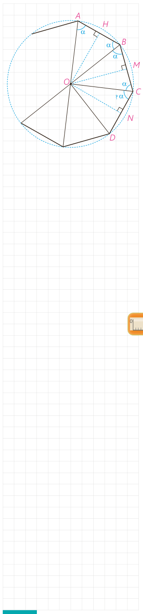

در فعالیت زیر نشان می‌دهیم هر چندضلعی منتظم، هم محاطی و هم محیطی است:

## فعالیت

فرض کنید اندازۀ هر زاویۀ $n$ ضلعی منتظم $ABCD\ldots$، $2\alpha$ باشد؛ عمود منصف‌های دو ضلع $AB$ و $BC$ را رسم می‌کنیم. فرض کنیم در $O$ متقاطع‌اند. بنابراین $OA=\ldots=OC$.

پس $\triangle OAB\cong\triangle OBC$ چرا؟ $\angle OAB=\angle OBA=\angle OBC=\angle OCB=\alpha$.

اکنون از $D$ به $O$ وصل می‌کنیم. چرا اندازۀ $\angle OCD$ برابر $\alpha$ است؟ چرا $\triangle OCD\cong\triangle OCB$؟ و $OA=OB=OC=OD$؟

با ادامۀ این روند داریم:

$OA=OB=OC=OD=\ldots$ و $OH=ON=OM=\ldots$ بنابراین، $O$ از همه رأس‌ها به یک فاصله است؛ پس مرکز دایره‌ای است که از تمام رأس‌های $n$ ضلعی منتظم می‌گذرد.

به همین ترتیب $O$ از تمام ضلع‌ها به یک فاصله است؛ پس مرکز دایره‌ای است که بر تمام ضلع‌های $n$ ضلعی منتظم مماس است.

## تمرین

۱- ثابت کنید یک ذوزنقه، محاطی است، اگر و تنها اگر متساوی‌الساقین باشد.

۲- مساحت مثلث متساوی‌الاضلاعی را به‌دست آورید که در دایره‌ای به شعاع $R$ محاط شده باشد.

۳- ثابت کنید عمود منصف یک ضلع هر مثلث و نیمساز زاویۀ مقابل به آن ضلع، یکدیگر را روی دایرۀ محیطی مثلث قطع می‌کنند.

۴- یک ذوزنقه، هم محیطی است و هم محاطی. ثابت کنید مساحت این ذوزنقه برابر است با میانگین حسابی دو قاعدۀ آن ضرب در میانگین هندسی آنها.

۵- اگر $r_a$ و $r_b$ و $r_c$ شعاع‌های سه دایره محاطی خارجی مثلث و $r$ شعاع دایره محاطی داخلی باشد، نشان دهید:

$$\frac1{r_a}+\frac1{r_b}+\frac1{r_c}=\frac1r$$

