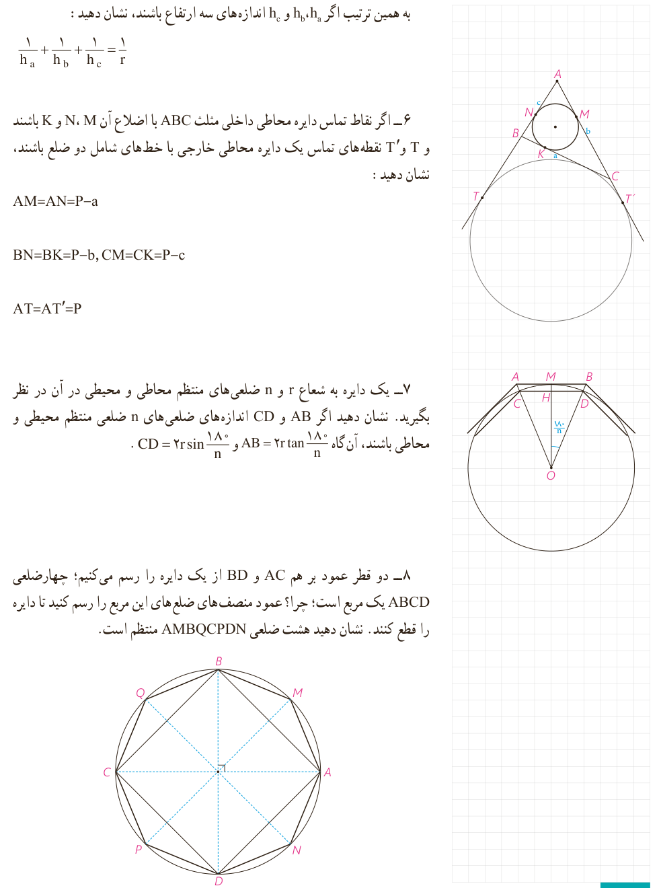

به همین ترتیب اگر $h_a,h_b$ و $h_c$ اندازه‌های سه ارتفاع باشند، نشان دهید:

$$\frac1{h_a}+\frac1{h_b}+\frac1{h_c}=\frac1r$$

۶- اگر نقاط تماس دایرۀ محاطی داخلی مثلث $ABC$ با اضلاع آن $M$، $N$ و $K$ باشند و $T$ و $T'$ نقطه‌های تماس یک دایرۀ محاطی خارجی با خط‌های شامل دو ضلع باشند، نشان دهید:

$$AM=AN=P-a$$
$$BN=BK=P-b,\quad CM=CK=P-c$$
$$AT=AT'=P$$

۷- یک دایره به شعاع $r$ و $n$ ضلعی‌های منتظم محاطی و محیطی در آن در نظر بگیرید. نشان دهید اگر $AB$ و $CD$ اندازه‌های ضلع‌های $n$ ضلعی منتظم محیطی و محاطی باشند، آن‌گاه $AB=2r\tan\frac{180^\circ}{n}$ و $CD=2r\sin\frac{180^\circ}{n}$.

۸- دو قطر عمود بر هم $AC$ و $BD$ از یک دایره را رسم می‌کنیم؛ چهارضلعی $ABCD$ یک مربع است؛ چرا؟ عمود منصف‌های ضلع‌های این مربع را رسم کنید تا دایره را قطع کنند. نشان دهید هشت ضلعی $AMBQCPDN$ منتظم است.

