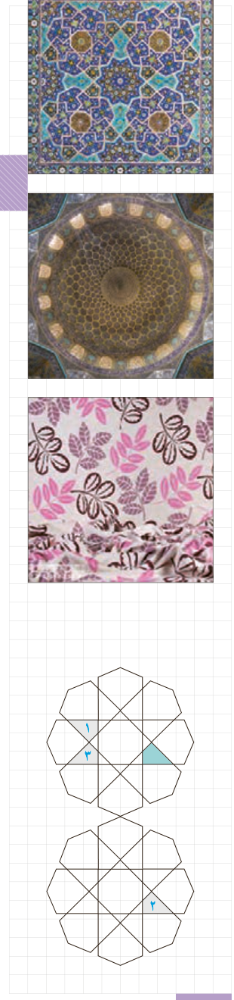

# درس اول: تبدیل‌های هندسی

در زندگی روزمره و بسیاری از پدیده‌های اطرافمان نظیر طراحی پارچه، نقش فرش، کاشی‌کاری، گچ‌بری و ... شکل‌های مختلف، طبق الگوی خاص تکرار می‌شود. در این فصل وضعیت‌های مختلفی را که هر شکل مشخص در اثر حرکت مجموعه نقاط در صفحه پیدا می‌کند، مطالعه و بررسی خواهیم کرد.

این حرکت‌ها می‌تواند دارای ویژگی‌های خاص قابل تعریف باشد؛ حرکتی که سال‌های قبل با نمونه‌هایی از آن آشنا شده‌اید و با توجه به نوع این ویژگی‌ها، آنها را انتقال، بازتاب (تقارن محوری) یا دوران نامیده‌اید. انتقال، بازتاب و دوران را تبدیل‌های هندسی می‌نامیم.

تبدیل‌های مطرح شده در این کتاب می‌توانند موقعیت¹ (جایگاه شکل در صفحه) یا اندازۀ² شکل را تغییر دهند. تبدیل‌یافتۀ یک شکل را، تصویر آن می‌نامیم.

در سال‌های گذشته با مفاهیم بازتاب، انتقال و دوران تا حدودی آشنا شدید. در این فعالیت، این تبدیل‌ها و برخی ویژگی‌های آنها را به‌طور شهودی مرور و یادآوری خواهیم کرد.

## فعالیت

۱- به تصویر روبه‌رو دقت کنید.

اگر چهارضلعی‌های ۱، ۲ و ۳ را تبدیل‌یافتۀ چهارضلعی رنگ شده بدانیم:

الف) کدام چهار ضلعی، انتقال‌یافتۀ چهارضلعی رنگ‌شده است؟

ب) کدام چهارضلعی بازتاب چهارضلعی رنگ‌شده است؟

پ) کدام شکل، دوران یافتۀ شکل رنگ‌شده است؟

۱- Position

۲- Size

