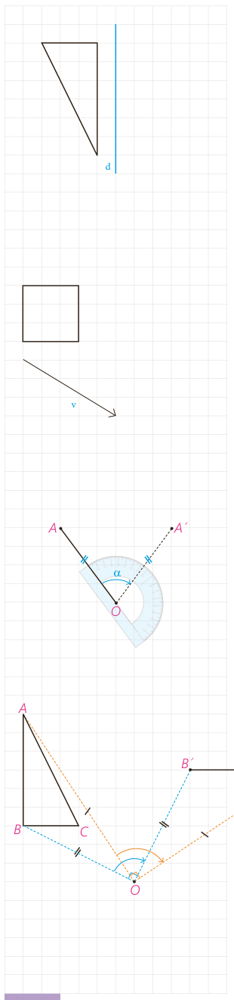

۲- الف) بازتاب شکل روبه‌رو را نسبت به خط $d$ رسم کنید. (توضیح دهید که چگونه این کار را انجام می‌دهید. در این حالت خط $d$ نسبت به پاره‌خطی که هر نقطه را به تصویرش نظیر می‌کند، چه وضعیتی دارد؟)

ب) آیا این تبدیل، موقعیت شکل اولیه را تغییر می‌دهد؟ اندازه‌ها را چطور؟

پ) آیا در این تبدیل، شیب هر پاره‌خط با شیب پاره‌خط متناظر در تصویر آن برابر است؟

ت) آیا حالتی وجود دارد که بازتاب، شیب خط را حفظ کند؟

۳- الف) تصویر شکل روبه‌رو را تحت انتقال با بردار $v$ رسم کنید (توضیح دهید که چگونه این کار را انجام می‌دهید). در این حالت پاره‌خط‌هایی که هر نقطه را به تصویرش نظیر می‌کنند، نسبت به هم چه وضعیتی دارند؟

ب) آیا این تبدیل، موقعیت شکل اولیه را حفظ می‌کند؟ اندازه‌ها را چطور؟

پ) آیا در این تبدیل، شیب هر پاره‌خط با شیب پاره‌خط متناظر در تصویر آن برابر است؟

ت) آیا با انجام این تبدیل اندازۀ زاویه‌ها ثابت می‌ماند؟

۴- در سال‌های گذشته دیدید که برای دوران دادن هر شکل به مرکز دوران $O$ و به اندازۀ زاویۀ $\alpha$، کافی است هر نقطه از شکل، مثل نقطۀ $A$ را به مرکز دوران یعنی $O$ وصل کنیم؛ سپس در جهت خواسته شده به کمک $OA$ زاویه‌ای برابر $\alpha$ رسم، و روی ضلع دیگر این زاویه پاره‌خطی به اندازۀ $OA$ جدا کنیم تا نقطۀ $A'$ به دست آید.

می‌خواهیم مثلث $ABC$ را حول مرکز $O$، ۹۰ درجه در جهت حرکت عقربه‌های ساعت دوران دهیم؛ به ترتیبی که گفته شد نقاط $A$ و $B$ را دوران داده‌ایم.

الف) به همین ترتیب تصویر نقطۀ $C$ را پیدا، و شکل را کامل کنید.

ب) آیا این تبدیل، موقعیت شکل اولیه را حفظ می‌کند؟ اندازه‌ها را چطور؟

پ) آیا در این تبدیل، همواره شیب پاره‌خط اولیه با شیب پاره‌خط تصویر آن برابر است؟

ت) آیا می‌توانید زاویۀ دوران را طوری تعیین کنید که دوران تحت آن، شیب خط را حفظ کند؟

