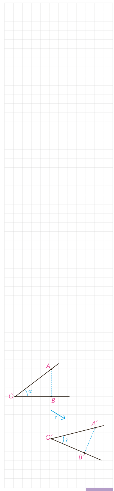

به طور شهودی می‌توان دید که بازتاب، انتقال و دوران، می‌توانند موقعیت شکل را تغییر دهند ولی اندازۀ پاره‌خط‌ها و زاویه‌ها را تغییر نمی‌دهند.

در ادامۀ این فصل با تبدیلی آشنا خواهید شد که در آن اندازۀ زاویه‌ها حفظ می‌شود ولی برخلاف سه تبدیل صفحۀ قبل، اندازۀ پاره‌خط‌ها می‌تواند تغییر کند. این تبدیل را تجانس می‌نامیم.

حال که به‌طور شهودی، برخی ویژگی‌های تبدیل‌های مختلف را مرور کردیم در ادامه با دقت بیشتری به تعریف تبدیل، معرفی، ویژگی‌ها و کاربردهای آن خواهیم پرداخت.

**تعریف:** تبدیل $T$¹ در صفحۀ $P$، تابعی است که به هر نقطۀ $A$ از صفحۀ $P$، دقیقاً یک نقطه مانند $A'$ را از همان صفحه نظیر می‌کند و برعکس؛ هر نقطۀ $A'$ از صفحۀ $P$، تصویر دقیقاً یک نقطه $A$ از همان صفحه است. اگر تبدیل را با حرف $T$ نمایش دهیم به اختصار چنین می‌نویسیم:

$$T:P\to P,\qquad T(A)=A'$$

پیش از این به طور شهودی دریافتیم که بازتاب، انتقال و دوران طول پاره‌خط را حفظ می‌کنند؛ یعنی اندازۀ پاره‌خطی مثل $AB$ در شکل اولیه با اندازۀ پاره‌خط $A'B'$ در تصویر آن برابر است. این ویژگی را اصطلاحاً طولپایی یا ایزومتری می‌نامیم.

**تعریف:** تبدیل‌هایی که طول پاره‌خط را حفظ می‌کنند، تبدیل‌های طولپا (ایزومتری) نامیده می‌شوند. به عبارتی اگر داشته باشیم: $T(A)=A'$ و $T(B)=B'$، آن‌گاه داریم: $AB=A'B'$.

پیش از این به‌طور شهودی پذیرفتیم که در تبدیل‌هایی که مرور شد، اندازۀ زاویه حفظ می‌شود. در این فعالیت برای تبدیل طولپا این ادعا را اثبات می‌کنیم و در ادامه طولپا بودن بازتاب، انتقال و دوران را به‌طور دقیق‌تر مورد بررسی قرار خواهیم داد.

## فعالیت

می‌خواهیم نشان دهیم هر تبدیل طولپا اندازۀ زاویه را حفظ می‌کند. فرض کنید $T$ تبدیلی طولپاست. و داریم:

$$T(A)=A',\quad T(B)=B',\quad T(O)=O'$$

۱- Transformation

