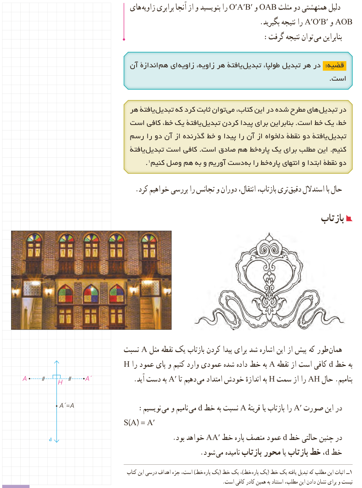

دلیل هم‌نهشتی دو مثلث $OAB$ و $O'A'B'$ را بنویسید و از آنجا برابری زاویه‌های $AOB$ و $A'O'B'$ را نتیجه بگیرید.

بنابراین می‌توان نتیجه گرفت:

**قضیه:** در هر تبدیل طولپا، تبدیل‌یافتۀ هر زاویه، زاویه‌ای هم‌اندازۀ آن است.

در تبدیل‌های مطرح شده در این کتاب، می‌توان ثابت کرد که تبدیل‌یافتۀ هر خط، یک خط است. بنابراین برای پیدا کردن تبدیل‌یافتۀ یک خط، کافی است تبدیل‌یافتۀ دو نقطۀ دلخواه از آن را پیدا و خط گذرنده از آن دو را رسم کنیم. این مطلب برای یک پاره‌خط هم صادق است. کافی است تبدیل‌یافتۀ دو نقطۀ ابتدا و انتهای پاره‌خط را به‌دست آوریم و به هم وصل کنیم.¹

حال با استدلال دقیق‌تری بازتاب، انتقال، دوران و تجانس را بررسی خواهیم کرد.

## بازتاب

همان‌طور که پیش از این اشاره شد برای پیدا کردن بازتاب یک نقطه مثل $A$ نسبت به خط $d$ کافی است از نقطۀ $A$ به خط داده شده عمودی وارد کنیم و پای عمود را $H$ بنامیم. حال $AH$ را از سمت $H$ به اندازۀ خودش امتداد می‌دهیم تا $A'$ به دست آید.

در این صورت $A'$ را بازتاب یا قرینۀ $A$ نسبت به خط $d$ می‌نامیم و می‌نویسیم:

$$S(A)=A'$$

در چنین حالتی خط $d$ عمود منصف پاره‌خط $AA'$ خواهد بود.

خط $d$، خط بازتاب یا محور بازتاب نامیده می‌شود.

۱- اثبات این مطلب که تبدیل یافتۀ یک خط (یک پاره‌خط)، یک خط (یک پاره‌خط) است، جزء اهداف درسی این کتاب نیست و برای نشان دادن این مطلب، استناد به همین کادر کافی است.

