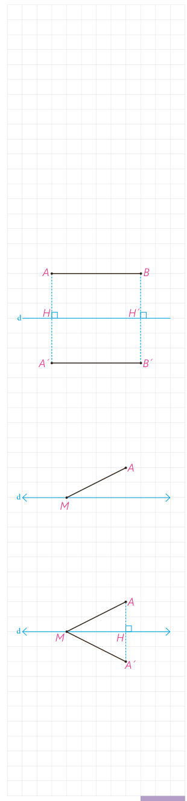

اگر نقطه‌ای روی خط بازتاب باشد، تصویر آن بر خودش منطبق می‌شود؛ به عبارتی $A'$ همان $A$ است.

**تعریف:** در هر تبدیل، نقطه‌ای را که تبدیل‌یافتۀ آن بر خود آن نقطه منطبق می‌شود، نقطۀ ثابت تبدیل می‌نامند.

بنابراین بازتاب نسبت به خط، بی‌شمار نقطۀ ثابت تبدیل دارد.

## فعالیت

می‌خواهیم با استدلال دقیق‌تری نشان دهیم بازتاب، تبدیلی طولپا است. حالت‌های مختلف یک پاره‌خط را نسبت به خط بازتاب $d$ در نظر می‌گیریم و در هر حالت نشان می‌دهیم که اندازۀ پاره‌خط با اندازۀ تصویر آن برابر است.

الف) ابتدا مسئله را برای حالتی در نظر می‌گیریم که $AB$ با خط $d$ موازی است. بازتاب $A$ و $B$ را نسبت به خط $d$ پیدا می‌کنیم و آن را $A'$ و $B'$ می‌نامیم.

چهارضلعی $ABA'B'$ چه چهارضلعی است؟ چرا؟ طول پاره‌خط‌های $AB$ و $A'B'$ نسبت به هم چگونه‌اند؟

ب) حال فرض می‌کنیم که فقط یکی از نقاط انتهایی پاره‌خط داده شده روی خط بازتاب باشد. (اگر هر دو نقطۀ ابتدا و انتهای پاره‌خط داده شده روی خط بازتاب باشند، اثبات بدیهی است؛ چرا؟)

بازتاب $A$ نسبت به خط $d$، نقطۀ $A'$ و بازتاب $M$، خود $M$ است. به عبارتی: $S(A)=A'$ و $S(M)=M$.

آیا می‌توانید به کمک هم‌نهشتی مثلث‌ها، دلیلی برای تساوی $MA=MA'$ ارائه کنید؟ آیا می‌توانید این تساوی را به روش دیگری نشان دهید؟ (از خاصیت عمود منصف یک پاره‌خط کمک بگیرید.)

