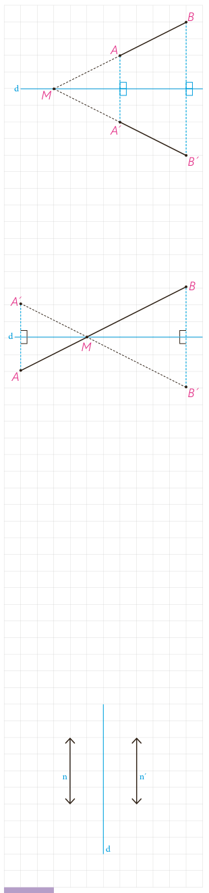

پ) در حالتی که پاره‌خط $AB$ با خط بازتاب $d$، نه موازی و نه متقاطع باشد، پاره‌خط $AB$ را امتداد می‌دهیم تا خط بازتاب را در نقطۀ $M$ قطع کند. نقطۀ $B'$ بازتاب نقطۀ $B$ را نسبت به خط بازتاب پیدا، و پاره‌خط $MB'$ را رسم می‌کنیم. ادعا می‌کنیم که تصویر نقطۀ $A$ نیز روی خط $MB'$ واقع می‌شود؛ چرا؟

حال داریم:

$$\left.\begin{aligned}AB&=MB-\ldots\\A'B'&=\ldots-\ldots\\MA&=\ldots\quad MB=\ldots\quad\text{با توجه به قسمت ب}\end{aligned}\right\}\Rightarrow\ldots=\ldots$$

ت) در حالتی که پاره‌خط $AB$ خط بازتاب را در نقطه‌ای مثل $M$ قطع کند، بازتاب نقطۀ $A$ را نسبت به خط $d$ پیدا می‌کنیم و آن را نقطۀ $A'$ می‌نامیم. پاره‌خط $MA'$ را رسم می‌کنیم و امتداد می‌دهیم و ادعا می‌کنیم که بازتاب نقطۀ $B$ یعنی نقطۀ $B'$ هم بر امتداد $MA'$ واقع است؛ چرا؟

حال داریم:

$$\left.\begin{aligned}AB&=AM+\ldots\\A'B'&=\ldots+\ldots\\AM&=\ldots\quad MB=\ldots\quad\text{با توجه به قسمت ب}\end{aligned}\right\}\Rightarrow\ldots=\ldots$$

تذکر: حالتی که پاره‌خط $AB$ بر خط بازتاب عمود است، به‌عنوان تمرین به شما واگذار شده است.

نتیجۀ این مراحل را می‌توان در قالب این قضیه بیان کرد:

**قضیه:** در هر بازتاب، اندازۀ هر پاره‌خط و اندازۀ تصویر آن با هم برابرند.

به عبارتی این قضیه نشان می‌دهد که بازتاب، تبدیلی طولپا است و برای هر دو نقطۀ $A$ و $B$ از صفحۀ $P$ که $S(A)=A'$ و $S(B)=B'$ داریم: $AB=A'B'$.

## فعالیت

می‌خواهیم بررسی کنیم که آیا بازتاب، شیب خط را هم حفظ می‌کند. مسئله را برای سه حالت کلی در نظر می‌گیریم: وقتی خط داده شده با خط بازتاب موازی باشد، وقتی عمود باشد و وقتی نه عمود باشد و نه موازی.

الف) اگر خط $n$ موازی خط بازتاب $d$ باشد، تصویر آن را تحت بازتاب، خط $n'$ می‌نامیم. خطوط $n$ و $n'$ نسبت به هم چه وضعی دارند؟ چرا؟ آیا در این حالت بازتاب، شیب خط را حفظ می‌کند؟

