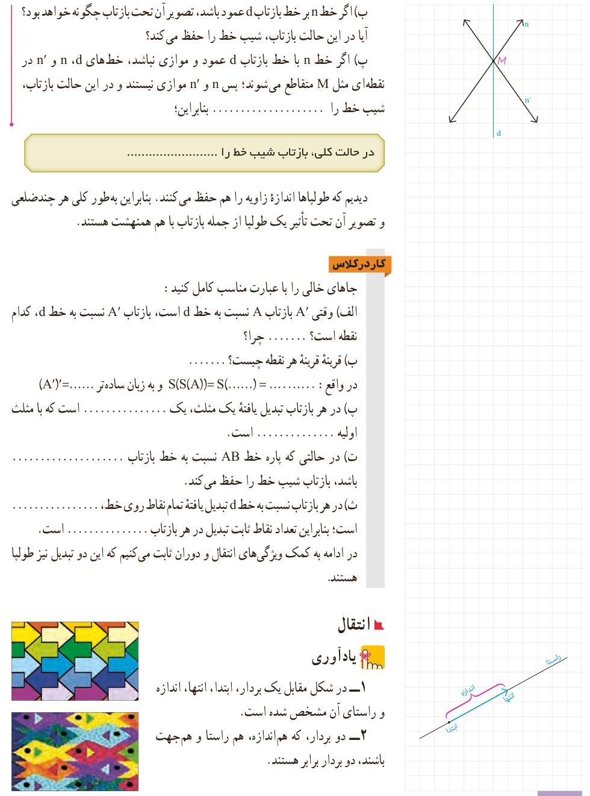

ب) اگر خط $n$ بر خط بازتاب $d$ عمود باشد، تصویر آن تحت بازتاب چگونه خواهد بود؟ آیا در این حالت بازتاب، شیب خط را حفظ می‌کند؟

پ) اگر خط $n$ با خط بازتاب $d$ عمود و موازی نباشد، خط‌های $d$، $n$ و $n'$ در نقطه‌ای مثل $M$ متقاطع می‌شوند؛ پس $n$ و $n'$ موازی نیستند و در این حالت بازتاب، شیب خط را .................... بنابراین:

در حالت کلی، بازتاب شیب خط را ....................

دیدیم که طولپاها اندازۀ زاویه را هم حفظ می‌کنند. بنابراین به‌طور کلی هر چندضلعی و تصویر آن تحت تأثیر یک طولپا از جمله بازتاب با هم هم‌نهشت هستند.

## کار در کلاس

جاهای خالی را با عبارت مناسب کامل کنید:

الف) وقتی $A'$ بازتاب $A$ نسبت به خط $d$ است، بازتاب $A'$ نسبت به خط $d$، کدام نقطه است؟ .......... چرا؟

ب) قرینۀ قرینۀ هر نقطه چیست؟ .......... در واقع: $S(S(A))=S(\ldots)=\ldots$ و به زبان ساده‌تر $(A')'=\ldots$

پ) در هر بازتاب تبدیل یافتۀ یک مثلث، یک .................... است که با مثلث اولیه .................... است.

ت) در حالتی که پاره‌خط $AB$ نسبت به خط بازتاب .................... باشد، بازتاب شیب خط را حفظ می‌کند.

ث) در هر بازتاب نسبت به خط $d$ تبدیل‌یافتۀ تمام نقاط روی خط، .................... است؛ بنابراین تعداد نقاط ثابت تبدیل در هر بازتاب .................... است.

در ادامه به کمک ویژگی‌های انتقال و دوران ثابت می‌کنیم که این دو تبدیل نیز طولپا هستند.

## انتقال

### یادآوری

۱- در شکل مقابل یک بردار، ابتدا، انتها، اندازه و راستای آن مشخص شده است.

۲- دو بردار، که هم‌اندازه، هم‌راستا و هم‌جهت باشند، دو بردار برابر هستند.

