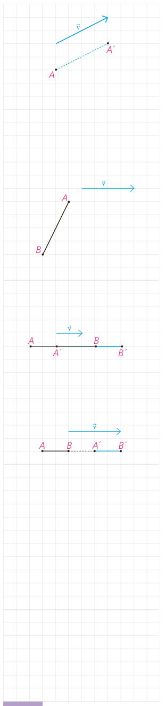

در سال‌های گذشته دیدید که برای انتقال دادن یک شکل، کافی است تصویر هر نقطه از شکل را به کمک بردار انتقال پیدا کنیم؛ یعنی اگر نقطۀ $A'$ تصویر نقطۀ $A$ باشد، آن‌گاه $\overrightarrow{AA'}=\vec v$.

**تعریف:** انتقال $T$¹ تحت بردار $\vec v$، تبدیلی از صفحه است که در آن، تصویر هر نقطۀ $A$ از صفحۀ $P$، نقطه‌ای مانند $A'$ در همان صفحه است که $\overrightarrow{AA'}=\vec v$.

## فعالیت

۱- می‌خواهیم نشان دهیم انتقال، تبدیل طولپاست.

الف) اگر پاره‌خط دلخواه $AB$ با بردار $\vec v$ موازی نباشد، تبدیل یافتۀ $AB$ را با بردار $\vec v$ رسم کنید و آن را $A'B'$ بنامید و نشان دهید: $AB=A'B'$.

راهنمایی: می‌دانیم که اگر در یک چهارضلعی، دو ضلع روبه‌رو موازی و مساوی باشند، آن چهارضلعی متوازی‌الاضلاع است.

ب) اگر پاره‌خط $AB$ با بردار $\vec v$ موازی باشد به کمک مجموع یا تفاضل پاره‌خط‌ها در هر دو حالت زیر نشان دهید: $AB=A'B'$.

(۱) $AB=AA'+\ldots$، $A'B'=\ldots+\ldots$، $AA'=\ldots$ طبق تعریف انتقال؛ بنابراین $\ldots=\ldots$.

(۲) $AB=AA'-\ldots$، $A'B'=\ldots-\ldots$، $AA'=\ldots$ طبق تعریف انتقال؛ بنابراین $\ldots=\ldots$.

تذکر: در حالتی که طول بردار $v$ با پاره‌خط $AB$ برابر است به کمک هر یک از روش‌های فوق می‌توان درستی رابطه را نشان داد.

بنابراین:

**قضیه:** در هر انتقال، اندازۀ هر پاره‌خط و اندازۀ تصویر آن با هم برابرند.

به عبارتی این قضیه نشان می‌دهد که انتقال، تبدیل طولپا است و برای هر دو نقطه $A$ و $B$ از صفحۀ $P$ که $T(A)=A'$ و $T(B)=B'$ داریم: $AB=A'B'$.

۲- در هر یک از حالت‌های قبل نشان دهید انتقال، شیب خط را هم حفظ می‌کند.

۱- Translation

