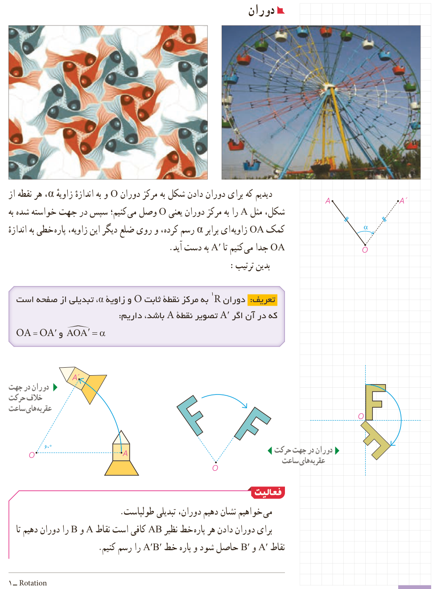

## دوران

دیدیم که برای دوران دادن شکل به مرکز دوران $O$ و به اندازۀ زاویۀ $\alpha$، هر نقطه از شکل، مثل $A$ را به مرکز دوران یعنی $O$ وصل می‌کنیم؛ سپس در جهت خواسته شده به کمک $OA$ زاویه‌ای برابر $\alpha$ رسم کرده، و روی ضلع دیگر این زاویه، پاره‌خطی به اندازۀ $OA$ جدا می‌کنیم تا $A'$ به دست آید. بدین ترتیب:

**تعریف:** دوران $R$¹ به مرکز نقطۀ ثابت $O$ و زاویۀ $\alpha$، تبدیلی از صفحه است که در آن اگر $A'$ تصویر نقطۀ $A$ باشد، داریم: $OA=OA'$ و $\angle AOA'=\alpha$.

دوران در جهت خلاف حرکت عقربه‌های ساعت؛ دوران در جهت حرکت عقربه‌های ساعت.

## فعالیت

می‌خواهیم نشان دهیم دوران، تبدیلی طولپاست. برای دوران دادن هر پاره‌خط نظیر $AB$ کافی است نقاط $A$ و $B$ را دوران دهیم تا نقاط $A'$ و $B'$ حاصل شود و پاره‌خط $A'B'$ را رسم کنیم.

۱- Rotation

