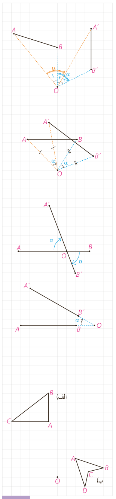

مسئله را برای حالت‌های مختلف در نظر می‌گیریم:

الف) مرکز دوران $O$ بر پاره‌خط $AB$ و امتداد آن واقع نباشد و زاویۀ دوران از زاویۀ $AOB$ بیشتر باشد.

با توجه به شکل $O_1+\ldots=O_2+\ldots=\alpha$. پس می‌توان مدعی شد که ............ = ............ . به کمک هم‌نهشتی دو مثلث $OAB$ و $OA'B'$ نشان دهید $AB$ و $A'B'$ هم‌اندازه‌اند.

ب) به طور مشابه نشان دهید که اگر $O$ بر پاره‌خط $AB$ واقع نباشد ولی زاویۀ دوران از زاویۀ $AOB$ کمتر باشد، باز هم تساوی $AB=A'B'$ برقرار است.

تذکر: در حالتی که $\angle AOB$ با زاویۀ دوران $\alpha$ برابر است با هریک از روش‌های فوق می‌توان درستی رابطه را نمایش داد.

پ) اگر نقطۀ $O$ روی پاره‌خط $AB$ باشد:

$$\left.\begin{aligned}AB&=AO+\ldots\\A'B'&=\ldots+\ldots\\OB&=\ldots\quad AO=\ldots\quad\text{طبق تعریف دوران}\end{aligned}\right\}\Rightarrow\ldots=\ldots$$

ت) به طریق مشابه نشان دهید اگر نقطۀ $O$ روی امتداد پاره‌خط $AB$ باشد، حکم برقرار است.

بنابراین:

**قضیه:** در هر دوران، اندازۀ هر پاره‌خط و تصویر آن با هم برابرند.

به عبارتی این قضیه نشان می‌دهد که دوران، تبدیلی طولپا است و برای هر دو نقطه $A$ و $B$ از صفحۀ $P$ که $R(A)=A'$ و $R(B)=B'$ داریم: $AB=A'B'$.

## کار در کلاس

دوران یافتۀ هر شکل را رسم کنید.

الف) دوران به مرکز $A$ و با زاویۀ $90^\circ$ در جهت حرکت عقربه‌های ساعت.

ب) دوران به مرکز $O$ و با زاویۀ $120^\circ$ در جهت خلاف حرکت عقربه‌های ساعت.

