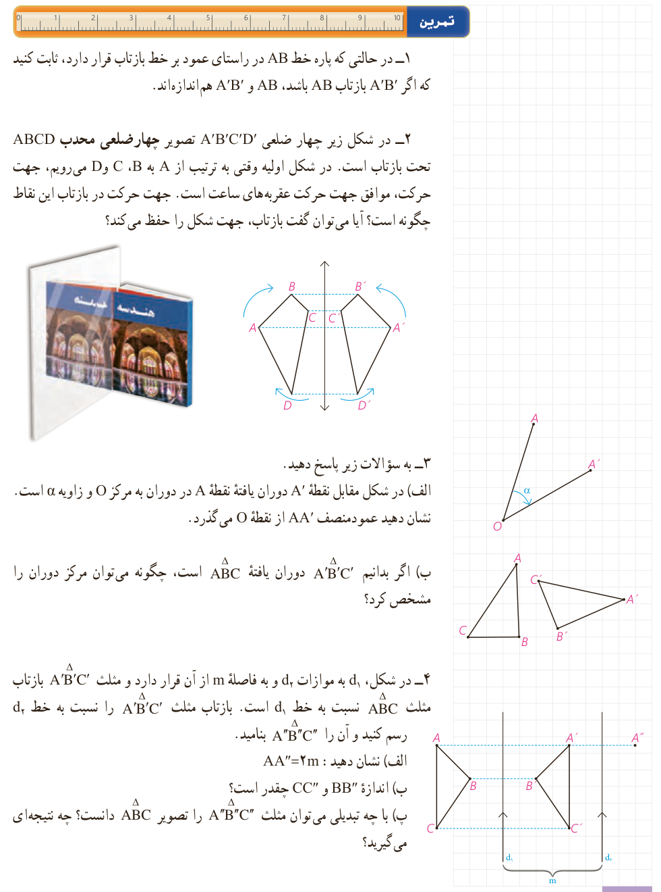

## تمرین

۱- در حالتی که پاره‌خط $AB$ در راستای عمود بر خط بازتاب قرار دارد، ثابت کنید که اگر $A'B'$ بازتاب $AB$ باشد، $AB$ و $A'B'$ هم‌اندازه‌اند.

۲- در شکل زیر چهار ضلعی $A'B'C'D'$ تصویر چهارضلعی محدب $ABCD$ تحت بازتاب است. در شکل اولیه وقتی به ترتیب از $A$ به $B$، $C$ و $D$ می‌رویم، جهت حرکت، موافق جهت حرکت عقربه‌های ساعت است. جهت حرکت در بازتاب این نقاط چگونه است؟ آیا می‌توان گفت بازتاب، جهت شکل را حفظ می‌کند؟

۳- به سؤالات زیر پاسخ دهید.

الف) در شکل مقابل نقطۀ $A'$ دوران یافتۀ نقطۀ $A$ در دوران به مرکز $O$ و زاویۀ $\alpha$ است. نشان دهید عمودمنصف $AA'$ از نقطۀ $O$ می‌گذرد.

ب) اگر بدانیم $\triangle A'B'C'$ دوران یافتۀ $\triangle ABC$ است، چگونه می‌توان مرکز دوران را مشخص کرد؟

۴- در شکل، $d_1$ به موازات $d_2$ و به فاصلۀ $m$ از آن قرار دارد و مثلث $A'B'C'$ بازتاب مثلث $ABC$ نسبت به خط $d_1$ است. بازتاب مثلث $A'B'C'$ را نسبت به خط $d_2$ رسم کنید و آن را $A''B''C''$ بنامید.

الف) نشان دهید: $AA''=2m$.

ب) اندازۀ $BB''$ و $CC''$ چقدر است؟

پ) با چه تبدیلی می‌توان مثلث $A''B''C''$ را تصویر $ABC$ دانست؟ چه نتیجه‌ای می‌گیرید؟

