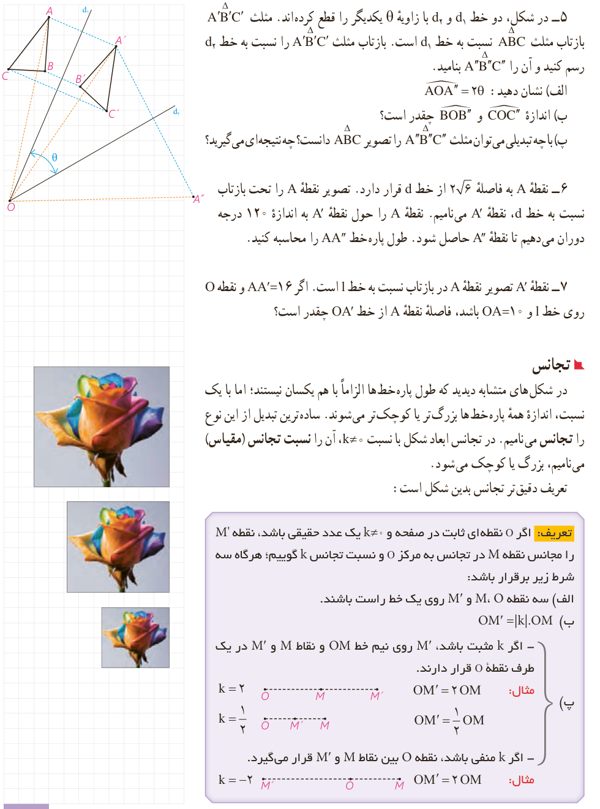

۵- در شکل، دو خط $d_1$ و $d_2$ با زاویۀ $\theta$ یکدیگر را قطع کرده‌اند. مثلث $A'B'C'$ بازتاب مثلث $ABC$ نسبت به خط $d_1$ است. بازتاب مثلث $A'B'C'$ را نسبت به خط $d_2$ رسم کنید و آن را $A''B''C''$ بنامید.

الف) نشان دهید: $\angle AOA''=2\theta$.

ب) اندازۀ $\angle BOB''$ و $\angle COC''$ چقدر است؟

پ) با چه تبدیلی می‌توان مثلث $A''B''C''$ را تصویر $ABC$ دانست؟ چه نتیجه‌ای می‌گیرید؟

۶- نقطۀ $A$ به فاصلۀ $2\sqrt6$ از خط $d$ قرار دارد. تصویر نقطۀ $A$ را تحت بازتاب نسبت به خط $d$، نقطۀ $A'$ می‌نامیم. نقطۀ $A$ را حول نقطۀ $A'$ به اندازۀ ۱۲۰ درجه دوران می‌دهیم تا نقطۀ $A''$ حاصل شود. طول پاره‌خط $AA''$ را محاسبه کنید.

۷- نقطۀ $A'$ تصویر نقطۀ $A$ در بازتاب نسبت به خط $l$ است. اگر $AA'=16$ و نقطۀ $O$ روی خط $l$ و $OA=10$ باشد، فاصلۀ نقطۀ $A$ از خط $OA'$ چقدر است؟

## تجانس

در شکل‌های متشابه دیدید که طول پاره‌خط‌ها الزاماً با هم یکسان نیستند؛ اما با یک نسبت، اندازۀ همۀ پاره‌خط‌ها بزرگ‌تر یا کوچک‌تر می‌شوند. ساده‌ترین تبدیل از این نوع را تجانس می‌نامیم. در تجانس ابعاد شکل با نسبت $k\ne0$، آن را نسبت تجانس (مقیاس) می‌نامیم، بزرگ یا کوچک می‌شود. تعریف دقیق‌تر تجانس بدین شکل است:

**تعریف:** اگر $O$ نقطه‌ای ثابت در صفحه و $k\ne0$ یک عدد حقیقی باشد، نقطۀ $M'$ را مجانس نقطۀ $M$ در تجانس به مرکز $O$ و نسبت تجانس $k$ گوییم؛ هرگاه سه شرط زیر برقرار باشد:

الف) سه نقطۀ $O$، $M$ و $M'$ روی یک خط راست باشند.

ب) $OM'=|k|\cdot OM$.

پ) اگر $k$ مثبت باشد، $M'$ روی نیم‌خط $OM$ و نقاط $M$ و $M'$ در یک طرف نقطۀ $O$ قرار دارند. مثال: $k=2$، $OM'=2OM$؛ $k=\frac12$، $OM'=\frac12OM$.

اگر $k$ منفی باشد، نقطۀ $O$ بین نقاط $M$ و $M'$ قرار می‌گیرد. مثال: $k=-2$، $OM'=2OM$.

