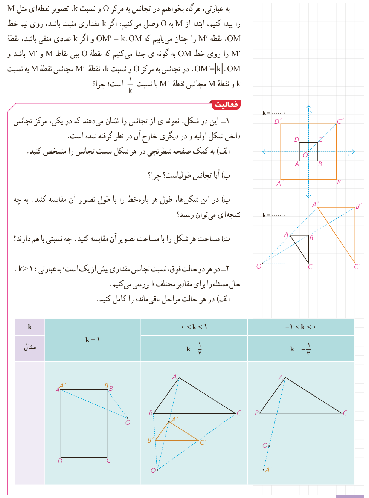

به عبارتی، هرگاه بخواهیم در تجانس به مرکز $O$ و نسبت $k$، تصویر نقطه‌ای مثل $M$ را پیدا کنیم، ابتدا از $M$ به $O$ وصل می‌کنیم؛ اگر $k$ مقداری مثبت باشد، روی نیم‌خط $OM$، نقطۀ $M'$ را چنان می‌یابیم که $OM'=k\cdot OM$ و اگر $k$ عددی منفی باشد، نقطۀ $M'$ را روی خط $OM$ به گونه‌ای جدا می‌کنیم که نقطۀ $O$ بین نقاط $M$ و $M'$ باشد و $OM'=|k|\cdot OM$. در تجانس به مرکز $O$ و نسبت $k$، نقطۀ $M'$ مجانس نقطۀ $M$ به نسبت $k$ و نقطۀ $M$ مجانس نقطۀ $M'$ با نسبت $\frac1k$ است؛ چرا؟

## فعالیت

۱- این دو شکل، نمونه‌ای از تجانس را نشان می‌دهند که در یکی، مرکز تجانس داخل شکل اولیه و در دیگری خارج آن در نظر گرفته شده است.

الف) به کمک صفحۀ شطرنجی در هر شکل نسبت تجانس را مشخص کنید.

ب) آیا تجانس طولپاست؟ چرا؟

پ) در این شکل‌ها، طول هر پاره‌خط را با طول تصویر آن مقایسه کنید. به چه نتیجه‌ای می‌توان رسید؟

ت) مساحت هر شکل را با مساحت تصویر آن مقایسه کنید. چه نسبتی با هم دارند؟

۲- در هر دو حالت فوق، نسبت تجانس مقداری بیش از یک است؛ به عبارتی $k>1$. حال مسئله را برای مقادیر مختلف $k$ بررسی می‌کنیم.

الف) در هر حالت مراحل باقی‌مانده را کامل کنید.

| وضعیت | مثال |
|---|---|
| $k=1$ | $k=1$ |
| $0<k<1$ | $k=\frac12$ |
| $-1<k<0$ | $k=-\frac13$ |

