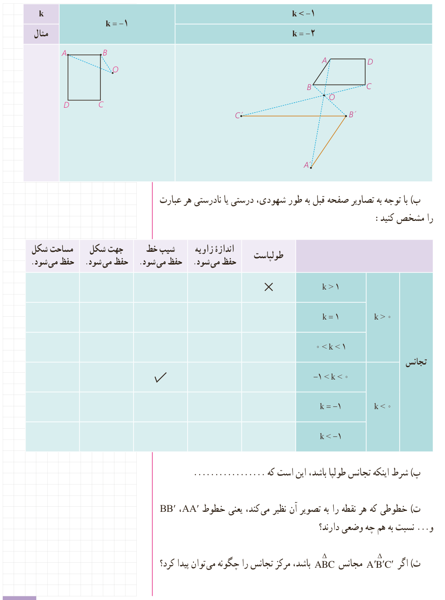

| وضعیت | مثال |
|---|---|
| $k=-1$ | $k=-1$ |
| $k<-1$ | $k=-2$ |

ب) با توجه به تصاویر صفحه قبل به طور شهودی، درستی یا نادرستی هر عبارت را مشخص کنید:

| تجانس | طولپاست | اندازۀ زاویه حفظ می‌شود | شیب خط حفظ می‌شود | جهت شکل حفظ می‌شود | مساحت شکل حفظ می‌شود |
|---|---|---|---|---|---|
| $k>1$ | × | | | | |
| $k=1$ | | | | | |
| $0<k<1$ | | | | | |
| $-1<k<0$ | | | ✓ | | |
| $k=-1$ | | | | | |
| $k<-1$ | | | | | |

پ) شرط اینکه تجانس طولپا باشد، این است که ....................

ت) خطوطی که هر نقطه را به تصویر آن نظیر می‌کند، یعنی خطوط $AA'$، $BB'$ و ... نسبت به هم چه وضعی دارند؟

ث) اگر $\triangle A'B'C'$ مجانس $\triangle ABC$ باشد، مرکز تجانس را چگونه می‌توان پیدا کرد؟

