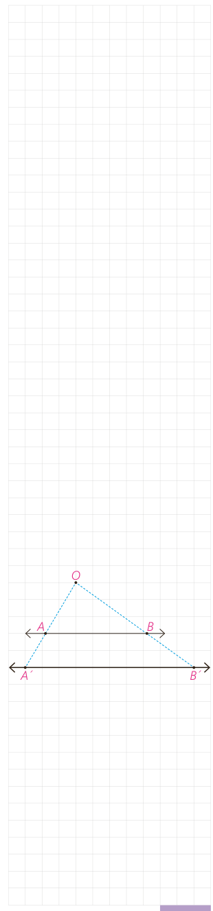

در تجانس به مرکز $O$ و نسبت $k$:

اگر $k>0$ تجانس را تجانس مستقیم می‌نامیم.

اگر $k<0$ تجانس را تجانس معکوس می‌نامیم.

اگر $|k|<1$ تصویر شکل ............ می‌شود و آن را انقباض می‌نامیم.

اگر ............ تصویر شکل، بزرگ‌تر می‌شود و آن را انبساط می‌نامیم.

حال که به طور شهودی با تجانس و چگونگی عملکرد آن روی شکل‌های هندسی آشنا شدید با استدلال دقیق‌تری ثابت خواهیم کرد که تجانس تبدیلی است که در حالت کلی شیب خط و اندازۀ زاویه را حفظ می‌کند.

## فعالیت

می‌خواهیم نشان دهیم تجانس، شیب خط را حفظ می‌کند. برای این منظور، تجانس $D$¹ با مرکز تجانس $O$ و نسبت تجانس $k$ و خط $AB$ را در نظر می‌گیریم؛ دو حالت اتفاق می‌افتد:

الف) نقطۀ $O$ روی خط $AB$ است.

حل: در این حالت بدیهی است که نقاط $A'$ و $B'$ مجانس‌های نقاط $A$ و $B$، روی خط $AB$ واقع می‌شوند؛ بنابراین $A'B'$ بر $AB$ واقع است و شیب خط تغییری نمی‌کند.

ب) نقطۀ $O$ غیرواقع بر خط $AB$ است.

حل: در این صورت اگر نقاط $A'$ و $B'$ به ترتیب، مجانس‌های نقاط $A$ و $B$ باشند، طبق تعریف داریم:

$$\left\{\begin{aligned}OA'&=k\cdot OA\\OB'&=\ldots\end{aligned}\right.\Rightarrow\frac{OA'}{OA}=\frac{\ldots}{\ldots}=\ldots\Rightarrow AB\parallel A'B'\quad(\text{چرا؟})$$

پس در این حالت نیز خط و تصویر آن با هم موازی‌اند و شیب دو خط، برابر است؛ بنابراین:

**قضیه:** تجانس، شیب خط را حفظ می‌کند.

تذکر: حالتی که $k<0$ به‌عنوان تمرین به شما واگذار شده است.

۱- Dilation

