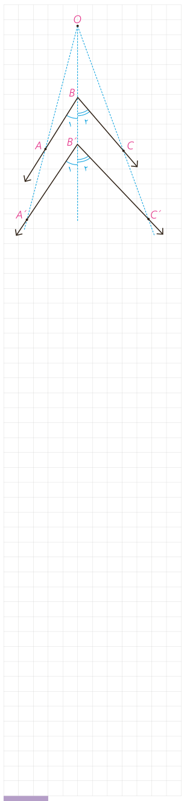

## فعالیت

می‌خواهیم نشان دهیم تجانس، اندازۀ زاویه را حفظ می‌کند. تجانس $D$ با مرکز تجانس $O$ و نسبت تجانس $k$ و زاویۀ $\angle ABC$ را در نظر می‌گیریم. مجانس این زاویه، یعنی زاویۀ $\angle A'B'C'$ را رسم می‌کنیم. به کمک قضیۀ قبل و شکل داده شده، ثابت کنید: $\angle ABC=\angle A'B'C'$.

نتیجۀ این فعالیت را در قالب قضیۀ زیر مطرح می‌کنیم:

**قضیه:** تجانس، اندازۀ زاویه را حفظ می‌کند.

تذکر: اثبات در حالتی که $k<0$ به‌عنوان تمرین به شما واگذار شده است.

## کار در کلاس

۱- الف) فرض کنید پاره‌خط $A'B'$ مجانس پاره‌خط $AB$ در تجانس به مرکز $O$ و نسبت $k$ باشد؛ نشان دهید: $\frac{A'B'}{AB}=|k|$ (نقطۀ $O$ را خارج $AB$ در نظر بگیرید.)

ب) اگر $n$ ضلعی $A'_1A'_2\ldots A'_n$ مجانس $n$ ضلعی $A_1A_2\ldots A_n$ باشد، نشان دهید این دو $n$ ضلعی با هم متشابه‌اند.

۲- با توجه به ویژگی‌های تجانس و به کمک مثال نقض نشان دهید دو شکل متشابه، الزاماً متجانس نیستند.

## فعالیت

پیش از این دیدیم که اگر نقطه‌ای روی خط بازتاب باشد، تصویر آن بر خودش منطبق می‌شود؛ به عبارتی $A'$ همان $A$ است و داریم $S(A)=A'=A$؛ این نقاط را نقاط ............ نامیدیم. اما برخی از تبدیل‌ها، هر نقطۀ صفحه را به خود آن نقطه نظیر می‌کنند؛ چنین تبدیل‌هایی را تبدیل همانی می‌نامیم.

**تعریف:** تبدیل $T$ را تبدیل همانی گوییم، هرگاه به ازای هر نقطۀ $A$ از صفحۀ $P$ داشته باشیم $T(A)=A$.

معمولاً تبدیل‌های همانی را با $I$ نمایش می‌دهند؛ پس $I(A)=A$.

