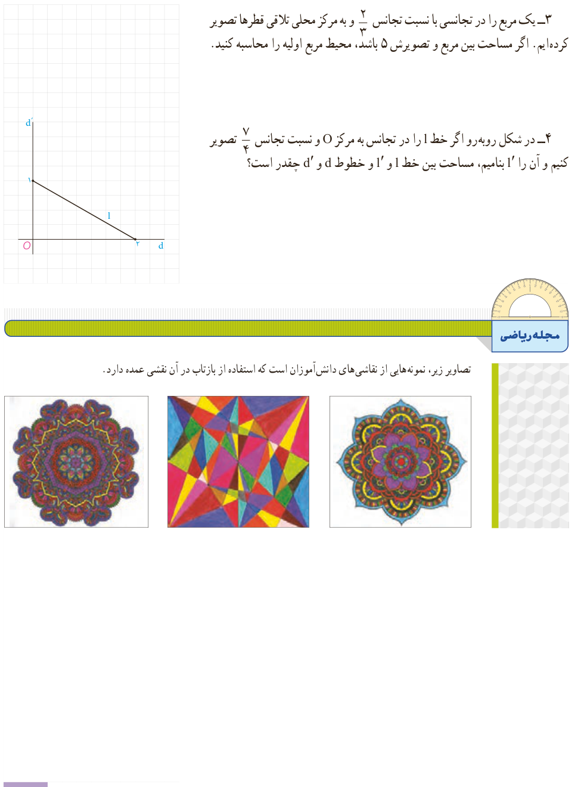

۳- یک مربع را در تجانسی با نسبت تجانس $\frac23$ و به مرکز محل تلاقی قطرها تصویر کرده‌ایم. اگر مساحت بین مربع و تصویرش ۵ باشد، محیط مربع اولیه را محاسبه کنید.

۴- در شکل روبه‌رو اگر خط $l$ را در تجانس به مرکز $O$ و نسبت تجانس $\frac74$ تصویر کنیم و آن را $l'$ بنامیم، مساحت بین خط $l$ و $l'$ و خطوط $d$ و $d'$ چقدر است؟

## مجلۀ ریاضی

تصاویر زیر، نمونه‌هایی از نقاشی‌های دانش‌آموزان است که استفاده از بازتاب در آن نقشی عمده دارد.

