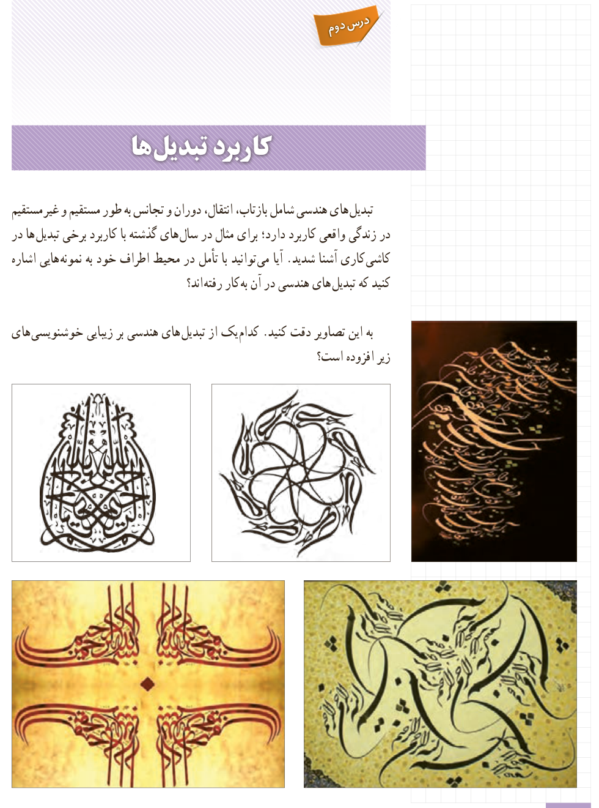

# درس دوم: کاربرد تبدیل‌ها

تبدیل‌های هندسی شامل بازتاب، انتقال، دوران و تجانس به طور مستقیم و غیرمستقیم در زندگی واقعی کاربرد دارد؛ برای مثال در سال‌های گذشته با کاربرد برخی تبدیل‌ها در کاشی‌کاری آشنا شدید. آیا می‌توانید با تأمل در محیط اطراف خود به نمونه‌هایی اشاره کنید که تبدیل‌های هندسی در آن به کار رفته‌اند؟

به این تصاویر دقت کنید. کدام‌یک از تبدیل‌های هندسی بر زیبایی خوشنویسی‌های زیر افزوده است؟

