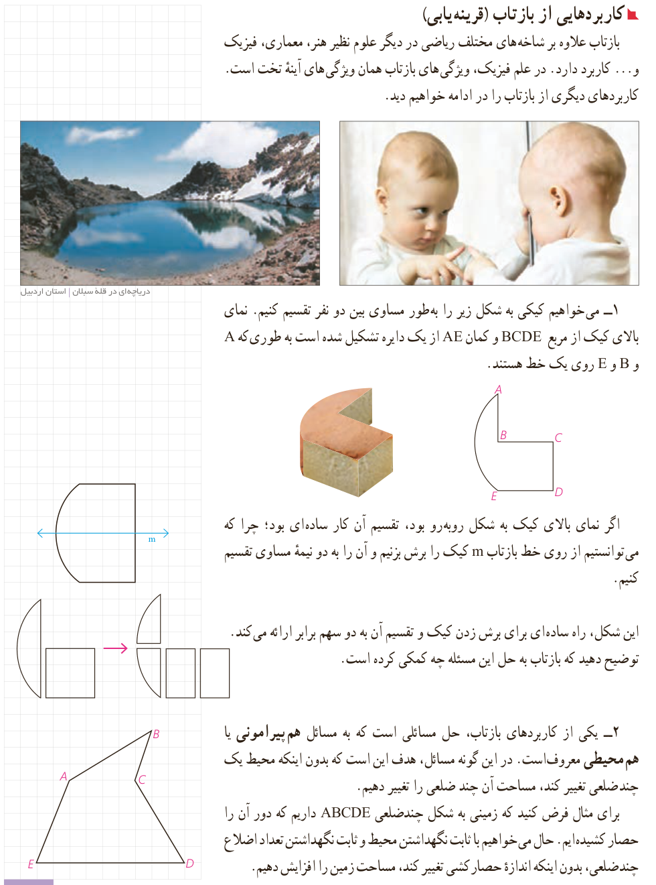

## کاربردهایی از بازتاب (قرینه‌یابی)

بازتاب علاوه بر شاخه‌های مختلف ریاضی در دیگر علوم نظیر هنر، معماری، فیزیک و ... کاربرد دارد. در علم فیزیک، ویژگی‌های بازتاب همان ویژگی‌های آینۀ تخت است. کاربردهای دیگری از بازتاب را در ادامه خواهیم دید.

دریاچه‌ای در قلۀ سبلان، استان اردبیل

۱- می‌خواهیم کیکی به شکل زیر را به‌طور مساوی بین دو نفر تقسیم کنیم. نمای بالای کیک از مربع $BCDE$ و کمان $AE$ از یک دایره تشکیل شده است به طوری که $A$ و $B$ و $E$ روی یک خط هستند.

اگر نمای بالای کیک به شکل روبه‌رو بود، تقسیم آن کار ساده‌ای بود؛ چرا که می‌توانستیم از روی خط بازتاب $m$ کیک را برش بزنیم و آن را به دو نیمۀ مساوی تقسیم کنیم.

این شکل، راه ساده‌ای برای برش زدن کیک و تقسیم آن به دو سهم برابر ارائه می‌کند. توضیح دهید که بازتاب به حل این مسئله چه کمکی کرده است.

۲- یکی از کاربردهای بازتاب، حل مسائلی است که به مسائل هم‌پیرامونی یا هم‌محیطی معروف است. در این گونه مسائل، هدف این است که بدون اینکه محیط یک چندضلعی تغییر کند، مساحت آن چند ضلعی را تغییر دهیم.

برای مثال فرض کنید که زمینی به شکل چندضلعی $ABCDE$ داریم که دور آن را حصار کشیده‌ایم. حال می‌خواهیم با ثابت نگهداشتن محیط و ثابت نگهداشتن تعداد اضلاع چندضلعی، بدون اینکه اندازۀ حصارکشی تغییر کند، مساحت زمین را افزایش دهیم.

