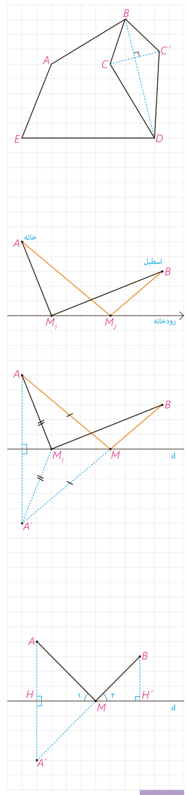

به کمک این تصویر توضیح دهید که این عمل را چگونه می‌توان انجام داد. چرا محیط چندضلعی $ABCDE$ با محیط چندضلعی $ABC'DE$ یکی است؟

## مسائل پیدا کردن کوتاه‌ترین مسیر

الف) هرون، ریاضی‌دانی است که به او دایرةالمعارف ریاضی و فیزیک لقب داده‌اند. او که در فاصلۀ زمانی ۲۵۰ تا ۱۵۰ سال قبل از میلاد مسیح در مصر زندگی می‌کرد برای نخستین بار به کمک بازتاب، دستور پیدا کردن کوتاه‌ترین مسیر را در شرایطی خاص ارائه کرد.

او با این مسئله روبه‌رو شده بود که: «مردی می‌خواهد برای برداشتن آب از خانه به ساحل رودخانه‌ای که لبۀ مستقیمی دارد برود و بعد سطل آب را به اصطبل¹ ببرد که در همان سمت رودخانه است. او از کدام نقطه از ساحل آب بردارد که مسافتی که در مجموع طی می‌کند، کمترین حالت ممکن باشد؟»

مسئله، پیدا کردن نقطۀ $M$ روی خط $d$ است به گونه‌ای که $AM+MB$ کمترین مقدار ممکن باشد.

هرون ابتدا بازتاب $A$ را نسبت به خط پیدا کرد و آن را $A'$ نامید. خط فرضی $A'B$ خط بازتاب را در نقطه‌ای مثل $M$ قطع می‌کند. او مدعی شد که $M$ جواب مسئله است و $AM+MB$ کوتاه‌ترین مسیر ممکن است. با هم دلیل ادعای هرون را بررسی می‌کنیم:

۱- برای هر نقطۀ دلخواه دیگری نظیر $M_1$ داریم $M_1A=M_1A'$ (و به همین ترتیب $AM=A'M$)؛ چرا؟

۲- در مثلث $A'M_1B$ داریم $A'M_1+M_1B>A'B$؛ چرا؟ از تساوی $A'B=A'M+MB$ و (۱) و (۲) ادعای هرون را اثبات کنید.

**سؤال:** در روش هرون نقطۀ $A'$ طرف دیگر رودخانه قرار دارد. اگر در عمل به دنبال یافتن کوتاه‌ترین مسیر مورد نظر باشیم و امکان رفتن به طرف دیگر رودخانه نباشد، چگونه نقطۀ $M$ را می‌توان پیدا کرد؟

راهنمایی: از تشابه دو مثلث $AHM$ و $BH'M$ کمک بگیرید و توجه داشته باشید که اندازه‌های $AH$ و $BH'$ دو مقدار معلوم هستند.

۱- جای سرپوشیده برای نگهداری چهارپایان به ویژه اسب

