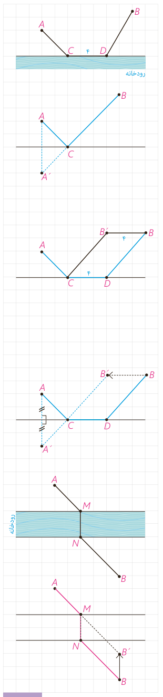

ب) دو شهر $A$ و $B$ مطابق شکل در یک طرف رودخانه‌ای واقع‌اند. می‌خواهیم جاده‌ای از $A$ به $B$ بسازیم به‌طوری که ۴ کیلومتر از این جاده در ساحل رودخانه ساخته شود. این ۴ کیلومتر را در چه قسمتی از رودخانه بسازیم تا مسیر $ACDB$ کوتاه‌ترین مسیر ممکن باشد؟

**حل:** مسئله را در چند مرحله حل می‌کنیم.

۱- اگر جادۀ ساحلی را از صورت مسئله حذف کنیم، به عبارتی اگر $CD=0$، این مسئله به کدام‌یک از مسائلی شبیه است که قبلاً دیده‌اید؟

۲- با توجه به شرایط مسئله، مسیر موردنظر، باید مسیری به شکل مسیر $ACDB$ باشد؛ اما:

طول مسیر $ACB'B$ = طول مسیر $ACDB$ (چرا؟)

بنابراین: ۴ + طول مسیر $ACB'$ = طول مسیر $ACDB$.

۳- پس کافی است برای پیدا کردن کوتاه‌ترین مسیر ممکن به شکل $ACDB$ مسیر را به گونه‌ای انتخاب کنیم که طول $ACB'$ کوتاه‌ترین طول ممکن باشد.

۴- به کمک مراحل ۱ تا ۳ و شکل روبه‌رو توضیح دهید که رسم کوتاه‌ترین مسیر $ACDB$ چگونه است.

## کار در کلاس

اگر دو شهر $A$ و $B$ دو طرف رودخانه باشند و بخواهیم جاده‌ای از $A$ به $B$ بسازیم به طوری که پل $MN$ بر راستای رودخانه عمود باشد، محل احداث پل را کجا در نظر بگیریم که مسیر $AMNB$ کوتاه‌ترین مسیر ممکن باشد؟

راهنمایی: به کمک فعالیت قبل و با توجه به تصویر داده شده، طریقۀ رسم مسیر $AMNB$ را شرح دهید و مشخص کنید چرا این مسیر، کوتاه‌ترین مسیر ممکن است.

