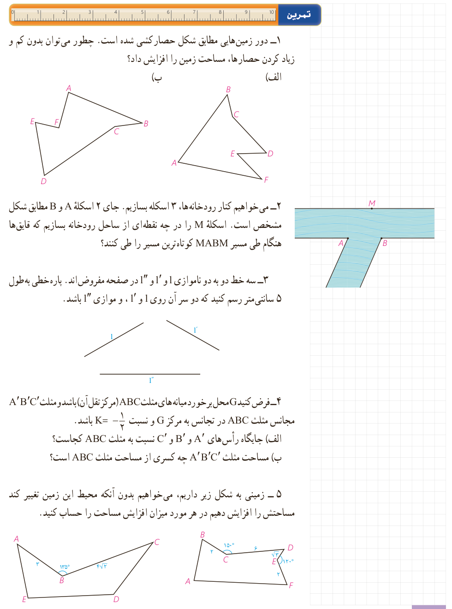

## تمرین

۱- دور زمین‌هایی مطابق شکل حصارکشی شده است. چطور می‌توان بدون کم و زیاد کردن حصارها، مساحت زمین را افزایش داد؟

۲- می‌خواهیم کنار رودخانه‌ها، ۳ اسکله بسازیم. جای ۲ اسکله $A$ و $B$ مطابق شکل مشخص است. اسکلۀ $M$ را در چه نقطه‌ای از ساحل رودخانه بسازیم که قایق‌ها هنگام طی مسیر $MABM$ کوتاه‌ترین مسیر را طی کنند؟

۳- سه خط دو به دو ناموازی $l$ و $l'$ و $l''$ در صفحه مفروض‌اند. پاره‌خطی به طول ۵ سانتی‌متر رسم کنید که دو سر آن روی $l$ و $l'$، و موازی $l''$ باشد.

۴- فرض کنید $G$ محل برخورد میانه‌های مثلث $ABC$ (مرکز ثقل آن) باشد و مثلث $A'B'C'$ مجانس مثلث $ABC$ در تجانس به مرکز $G$ و نسبت $K=-\frac12$ باشد.

الف) جایگاه رأس‌های $A'$ و $B'$ و $C'$ نسبت به مثلث $ABC$ کجاست؟

ب) مساحت مثلث $A'B'C'$ چه کسری از مساحت مثلث $ABC$ است؟

۵- زمینی به شکل زیر داریم، می‌خواهیم بدون آنکه محیط این زمین تغییر کند مساحتش را افزایش دهیم در هر مورد میزان افزایش مساحت را حساب کنید.

