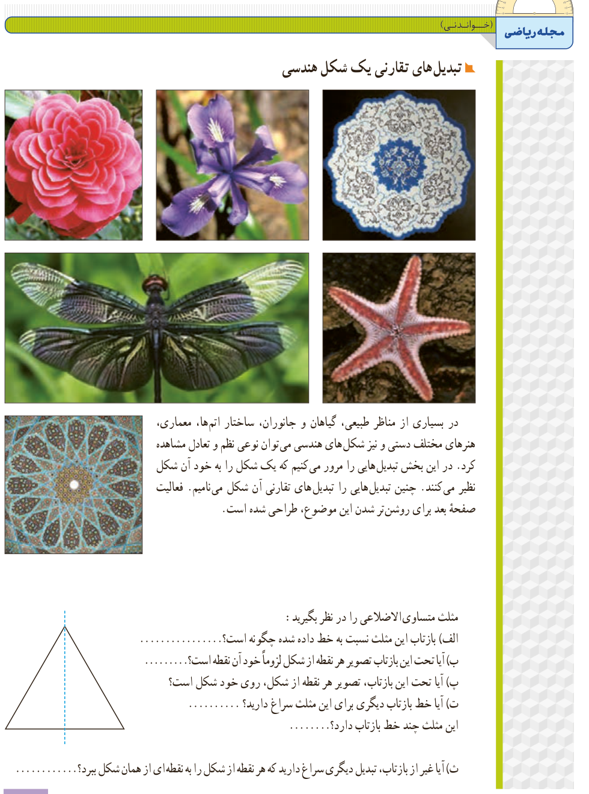

# مجلۀ ریاضی (خواندنی)

## تبدیل‌های تقارنی یک شکل هندسی

در بسیاری از مناظر طبیعی، گیاهان و جانوران، ساختار اتم‌ها، معماری، هنرهای مختلف دستی و نیز شکل‌های هندسی می‌توان نوعی نظم و تعادل مشاهده کرد. در این بخش تبدیل‌هایی را مرور می‌کنیم که یک شکل را به خود آن شکل نظیر می‌کنند. چنین تبدیل‌هایی را تبدیل‌های تقارنی آن شکل می‌نامیم. فعالیت صفحۀ بعد برای روشن‌تر شدن این موضوع، طراحی شده است.

مثلث متساوی‌الاضلاعی را در نظر بگیرید:

الف) بازتاب این مثلث نسبت به خط داده شده چگونه است؟ ....................

ب) آیا تحت این بازتاب تصویر هر نقطه از شکل لزوماً خود آن نقطه است؟ ............

پ) آیا تحت این بازتاب، تصویر هر نقطه از شکل، روی خود شکل است؟

ت) آیا خط بازتاب دیگری برای این مثلث سراغ دارید؟ ............ این مثلث چند خط بازتاب دارد؟ ............

ث) آیا غیر از بازتاب، تبدیل دیگری سراغ دارید که هر نقطه از شکل را به نقطه‌ای از همان شکل ببرد؟ ....................

