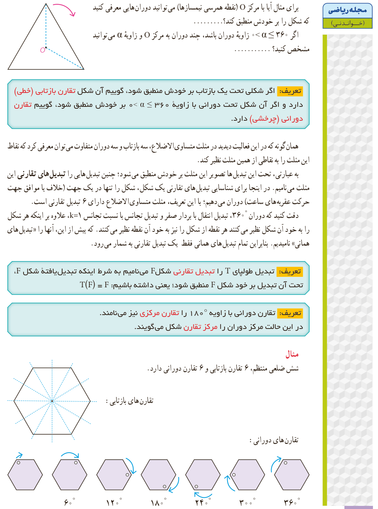

برای مثال آیا با مرکز $O$ (نقطۀ همرسی نیمسازها) می‌توانید دوران‌هایی معرفی کنید که شکل را بر خودش منطبق کند؟ ............ اگر $0<\alpha\le360^\circ$ زاویۀ دوران باشد، چند دوران به مرکز $O$ و زاویۀ $\alpha$ می‌توانید مشخص کنید؟ ............

**تعریف:** اگر شکلی تحت یک بازتاب بر خودش منطبق شود، گوییم آن شکل تقارن بازتابی (خطی) دارد و اگر آن شکل تحت دورانی با زاویۀ $0<\alpha\le360^\circ$ بر خودش منطبق شود، گوییم تقارن دورانی (چرخشی) دارد.

همان‌گونه که در این فعالیت دیدید در مثلث متساوی‌الاضلاع، سه بازتاب و سه دوران متفاوت می‌توان معرفی کرد که نقاط این مثلث را به نقاطی از همین مثلث نظیر کند.

به عبارتی، تحت این تبدیل‌ها تصویر این مثلث بر خودش منطبق می‌شود؛ چنین تبدیل‌هایی را تبدیل‌های تقارنی این مثلث می‌نامیم. در اینجا برای شناسایی تبدیل‌های تقارنی یک شکل، شکل را تنها در یک جهت (خلاف یا موافق جهت حرکت عقربه‌های ساعت) دوران می‌دهیم؛ با این تعریف، مثلث متساوی‌الاضلاع دارای ۶ تبدیل تقارنی است.

دقت کنید که دوران $360^\circ$، تبدیل انتقال با بردار صفر و تبدیل تجانس با نسبت تجانس $k=1$، علاوه بر اینکه هر شکل را به خود آن شکل نظیر می‌کنند هر نقطه از شکل را نیز به خود آن نقطه نظیر می‌کنند. که پیش از این، آنها را «تبدیل‌های همانی» نامیدیم. بنابراین تمام تبدیل‌های همانی فقط یک تبدیل تقارنی به شمار می‌رود.

**تعریف:** تبدیل طولپای $T$ را تبدیل تقارنی شکل $F$ می‌نامیم به شرط اینکه تبدیل‌یافتۀ شکل $F$، تحت آن تبدیل بر خود شکل $F$ منطبق شود؛ یعنی داشته باشیم: $T(F)=F$.

**تعریف:** تقارن دورانی با زاویۀ $180^\circ$ را تقارن مرکزی نیز می‌نامند. در این حالت مرکز دوران را مرکز تقارن شکل می‌گویند.

**مثال:** شش ضلعی منتظم، ۶ تقارن بازتابی و ۶ تقارن دورانی دارد.

تقارن‌های بازتابی؛ تقارن‌های دورانی: $60^\circ$، $120^\circ$، $180^\circ$، $240^\circ$، $300^\circ$، $360^\circ$.

