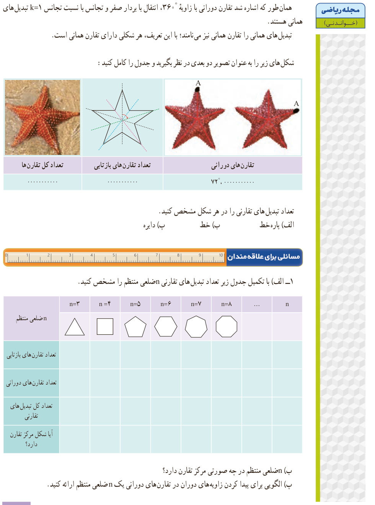

# مجلۀ ریاضی (خواندنی)

همان‌طور که اشاره شد تقارن دورانی با زاویۀ $360^\circ$، انتقال با بردار صفر و تجانس با نسبت تجانس $k=1$ تبدیل‌های همانی هستند.

تبدیل‌های همانی را تقارن همانی نیز می‌نامند؛ با این تعریف، هر شکلی دارای تقارن همانی است.

شکل‌های زیر را به عنوان تصویر دو بعدی در نظر بگیرید و جدول را کامل کنید:

| تقارن‌های دورانی | تعداد تقارن‌های بازتابی | تعداد کل تقارن‌ها |
|---|---|---|
| $72^\circ$، ............ | ............ | ............ |

تعداد تبدیل‌های تقارنی را در هر شکل مشخص کنید: الف) پاره‌خط؛ ب) خط؛ پ) دایره.

## مسائلی برای علاقه‌مندان

۱- الف) با تکمیل جدول زیر تعداد تبدیل‌های تقارنی $n$ ضلعی منتظم را مشخص کنید.

| $n$ ضلعی منتظم | ۳ | ۴ | ۵ | ۶ | ۷ | ۸ | ... | $n$ |
|---|---|---|---|---|---|---|---|---|
| تعداد تقارن‌های بازتابی | | | | | | | | |
| تعداد تقارن‌های دورانی | | | | | | | | |
| تعداد کل تبدیل‌های تقارنی | | | | | | | | |
| آیا شکل مرکز تقارن دارد؟ | | | | | | | | |

ب) $n$ ضلعی منتظم در چه صورتی مرکز تقارن دارد؟

پ) الگویی برای پیدا کردن زاویه‌های دوران در تقارن‌های دورانی یک $n$ ضلعی منتظم ارائه کنید.

