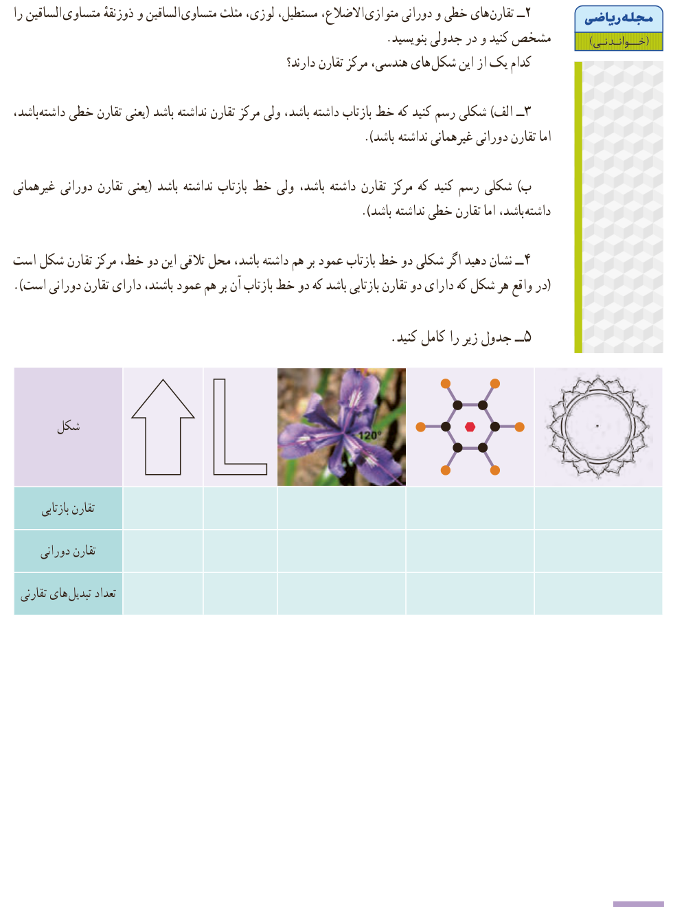

# مجلۀ ریاضی (خواندنی)

۲- تقارن‌های خطی و دورانی متوازی‌الاضلاع، مستطیل، لوزی، مثلث متساوی‌الساقین و ذوزنقۀ متساوی‌الساقین را مشخص کنید و در جدولی بنویسید. کدام یک از این شکل‌های هندسی، مرکز تقارن دارند؟

۳- الف) شکلی رسم کنید که خط بازتاب داشته باشد، ولی مرکز تقارن نداشته باشد (یعنی تقارن خطی داشته باشد، اما تقارن دورانی غیرهمانی نداشته باشد).

ب) شکلی رسم کنید که مرکز تقارن داشته باشد، ولی خط بازتاب نداشته باشد (یعنی تقارن دورانی غیرهمانی داشته باشد، اما تقارن خطی نداشته باشد).

۴- نشان دهید اگر شکلی دو خط بازتاب عمود بر هم داشته باشد، محل تلاقی این دو خط، مرکز تقارن شکل است (در واقع هر شکل که دارای دو تقارن بازتابی باشد که دو خط بازتاب آن بر هم عمود باشند، دارای تقارن دورانی است).

۵- جدول زیر را کامل کنید.

| شکل | پیکان | L | گل | شکل مولکولی | نقش دایره‌ای |
|---|---|---|---|---|---|
| تقارن بازتابی | | | | | |
| تقارن دورانی | | | | | |
| تعداد تبدیل‌های تقارنی | | | | | |

