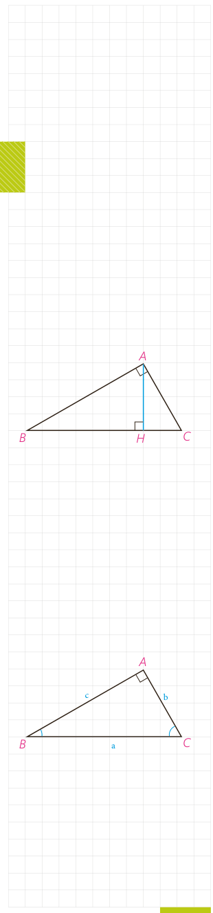

# درس اول: قضیۀ سینوس‌ها

## یادآوری

منظور از روابط طولی، رابطه‌هایی است که در مورد اندازه‌های پاره‌خط‌ها و زاویه‌ها در شکل‌های مختلف، بحث می‌کند. در سال گذشته روابط طولی زیر را در مثلث قائم‌الزاویه دیدیم:

۱- $AB^2=BC\cdot BH$
۲- $AC^2=BC\cdot CH$
۳- $AH^2=BH\cdot CH$
۴- $AB^2+AC^2=BC^2$
۵- $AB\cdot AC=BC\cdot AH$

اینک به ادامۀ بحث در مثلث‌های دلخواه می‌پردازیم.

## فعالیت ۱

در کتاب ریاضی ۱ (پایۀ دهم) با تعریف نسبت‌های مثلثاتی در مثلث قائم‌الزاویه آشنا شدید. با توجه به تعریف سینوس زاویه در مثلث قائم‌الزاویۀ $ABC$، جاهای خالی را پر کنید:

$$\sin B=\frac{\ldots}{\ldots}\Rightarrow\frac b{\sin B}=\ldots$$
$$\sin C=\frac{\ldots}{\ldots}\Rightarrow\frac c{\sin C}=\ldots$$
$$\sin A=\sin90^\circ=\ldots\Rightarrow\frac a{\sin A}=\ldots$$

بنابراین داریم:

در هر مثلث قائم‌الزاویه، نسبت اندازۀ هر ........ به .................... برابر است با اندازۀ ............ .

