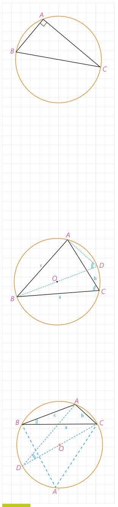

## فعالیت ۲

در کتاب هندسۀ ۱ دیدیم که عمودمنصف‌های اضلاع هر مثلث در یک نقطه همرس‌اند و در این کتاب دیدیم که این نقطه، مرکز دایرۀ محیطی مثلث است. دایرۀ محیطی مثلث قائم‌الزاویۀ $ABC$ را رسم می‌کنیم. مرکز این دایره، کجاست و چرا قطر آن با وتر مثلث برابر است؟

با توجه به نتیجۀ فعالیت (۱) می‌توانیم بگوییم:

در هر مثلث قائم‌الزاویه، نسبت اندازۀ هر ضلع به سینوس زاویۀ روبه‌رو به آن ضلع برابر است با اندازۀ ............ دایرۀ محیطی مثلث.

اکنون نشان می‌دهیم این نتیجه‌گیری برای هر مثلث دلخواه نیز درست است.

## فعالیت ۳

الف) مثلث $ABC$ با زاویه‌های حادۀ $A$ و $B$ و $C$ و دایرۀ محیطی آن به مرکز $O$ (که درون مثلث است) را درنظر می‌گیریم. قطر $BD$ را رسم و $D$ را به $A$ وصل می‌کنیم.

۱- زوایای $\widehat C$ و $\widehat D$ چرا با هم برابرند؟

۲- چرا مثلث $ABD$ در رأس $A$ قائم‌الزاویه است؟

۳- با توجه به دو قسمت قبل، داریم:

$$\sin C=\sin D,\quad \sin D=\frac{\ldots}{\ldots}\Rightarrow\sin C=\frac{\ldots}{2R}\Rightarrow\frac c{\sin C}=2R$$

۴- به‌طور مشابه (با وصل کردن $A$ و $C$ به مرکز و رسم قطرهای گذرنده از آن نقاط) خواهیم داشت: $\frac a{\sin A}=\ldots$ و $\frac b{\sin B}=\ldots$.

ب) حال فرض می‌کنیم یکی از زوایای مثلث، مثلاً $\widehat A$، منفرجه باشد ($\widehat A>90^\circ$)، در این صورت $O$، مرکز دایرۀ محیطی مثلث، بیرون مثلث است و نقطۀ $A'$ را روی کمان $BC$ طوری درنظر می‌گیریم که $O$ درون مثلث $A'BC$ بیفتد (یعنی مثلث $A'BC$ حاده‌الزاوایا باشد).

۱- زوایای $\widehat A$ (از مثلث $ABC$) و $\widehat{A'}$ نسبت به هم چگونه‌اند؟ چرا؟ $\widehat A+\widehat{A'}=180^\circ$ بنابراین با توجه به آنچه از مثلثات می‌دانیم، نتیجه می‌شود: $\sin A=\sin(\ldots-\widehat{A'})=\ldots$ و در مثلث $A'BC$ مطابق نتیجۀ قسمت (الف) می‌توانیم بنویسیم:

$$\frac a{\sin A'}=\ldots\Rightarrow\frac a{\sin A}=\ldots$$

