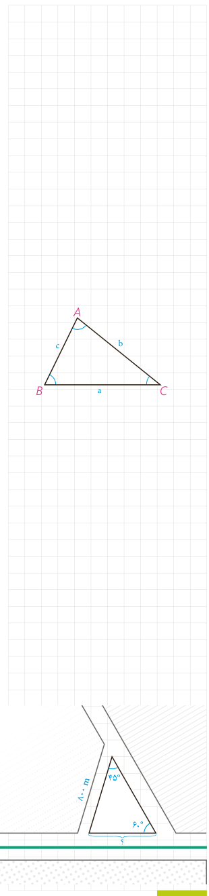

۲- قطر $CD$ را رسم می‌کنیم، چرا مثلث $ADC$ در رأس $A$ قائم‌الزاویه است؟ زاویۀ $\widehat D$ در این مثلث، با کدام زاویه از مثلث $ABC$ برابر است؟ چرا؟

۳- با توجه به تعریف نسبت‌های مثلثاتی در مثلث قائم‌الزاویۀ $ADC$ می‌توان نوشت:

$$\sin D=\frac{\ldots}{\ldots}=\frac b{\ldots}\Rightarrow\sin B=\frac b{2R}$$

و به‌طریق مشابه (با رسم قطر گذرنده از $B$) می‌توان ثابت کرد: $\sin C=\frac c{2R}$.

**نتیجه:** در هر مثلث دلخواه، نسبت اندازۀ هر ........ به ........ زاویۀ روبه‌رو به آن برابر است با ............

**قضیۀ سینوس‌ها:** در مثلث $ABC$ با اضلاع $BC=a$، $AC=b$ و $AB=c$ داریم:

$$\frac a{\sin A}=\frac b{\sin B}=\frac c{\sin C}=2R$$

که $R$ شعاع دایره محیطی مثلث است.

**مثال ۱:** در مثلث $ABC$، $BC=10\,\mathrm{cm}$ و $\widehat A=120^\circ$ و $AC=\frac{10\sqrt6}{3}$، مقدار شعاع دایرۀ محیطی مثلث و اندازۀ زوایای $\widehat B$ و $\widehat C$ را به‌دست آورید.

**حل:** به کمک قضیۀ سینوس‌ها می‌توان نوشت:

$$\frac a{\sin A}=2R\Rightarrow\frac{10}{\sin120^\circ}=2R,\quad\sin120^\circ=\sin(180^\circ-60^\circ)=\sin60^\circ=\frac{\sqrt3}{2}$$
$$2R=\frac{10}{\sqrt3/2},\quad R=\frac{10\sqrt3}{3}$$
$$\frac a{\sin A}=\frac b{\sin B}=2R\Rightarrow\frac{10\sqrt6/3}{\sin B}=\frac{20\sqrt3}{3}\Rightarrow\sin B=\frac{\sqrt2}{2}$$
$$B=45^\circ\text{ یا }135^\circ,\quad A=120^\circ\Rightarrow B=45^\circ\Rightarrow C=15^\circ$$

**مثال ۲:** از یک بلوار افقی، یک خیابان فرعی باریک با زاویۀ $60^\circ$ جدا شده است. اکنون شهرداری منطقه می‌خواهد یک خیابان فرعی دیگر به طول ۸۰۰ متر بنا کند تا با زاویۀ $45^\circ$ از خیابان فرعی اول جدا، و به بلوار منتهی شود. این خیابان از چه فاصله‌ای از رأس زاویۀ $60^\circ$ باید شروع شود و با بلوار چه زاویه‌ای می‌سازد؟

