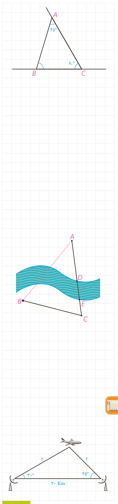

**حل:** با یک شکل مناسب مسئله را مدل‌سازی می‌کنیم. اولاً با توجه به مجموع اندازه‌های زوایای داخلی مثلث، روشن است که $\widehat B=180^\circ-(45^\circ+60^\circ)=75^\circ$؛ یعنی خیابان فرعی باید با زاویۀ $75^\circ$ از بلوار جدا شود. ثانیاً به کمک قضیۀ سینوس‌ها در مثلث $ABC$ داریم:

$$\frac{AB}{\sin C}=\frac{BC}{\sin A}\Rightarrow\frac{800}{\sin60^\circ}=\frac{BC}{\sin45^\circ}\Rightarrow BC=\frac{800(\sqrt2/2)}{\sqrt3/2}=\frac{800\sqrt2}{\sqrt3}=\frac{800\sqrt6}{3}\approx653.2\,\mathrm m$$

یعنی خیابان فرعی را باید از فاصلۀ تقریبی ۶۵۳/۲ متر با زاویۀ $75^\circ$ بنا کنیم.

## کار در کلاس

می‌خواهیم روی یک رودخانۀ عمیق بین دو نقطۀ $A$ و $B$ در دو طرف رودخانه، پلی بنا کنیم. برای محاسبات مربوط به احداث پل، باید فاصلۀ ابتدا و انتهای آن (یعنی طول $AB$) را به‌دست بیاوریم؛ اما امکان اندازه‌گیری مستقیم (به‌دلیل وجود رودخانه) وجود ندارد. برای این کار از نقطۀ $A$ در جهتی حرکت می‌کنیم تا با عبور از قسمت کم‌عمق رودخانه ($DE$) به نقطۀ $C$ برسیم و طول $BC$ را اندازه‌گیری می‌کنیم؛ سپس با زاویه‌یاب (تئودولیت) زاویۀ دید $AC$ از نقطۀ $B$ ($\widehat B$) و زاویۀ دید $AB$ از $C$ ($\widehat C$) را اندازه می‌گیریم. به‌صورت زیر نشان دهید با داشتن طول $BC$ و زوایای $\widehat B$ و $\widehat C$ می‌توان فاصلۀ $AB$ را به‌دست آورد:

$$\frac{BC}{\sin A}=\frac{AB}{\ldots}\Rightarrow\frac{BC}{\sin(180^\circ-(\ldots+\ldots))}=\frac{AB}{\ldots}\Rightarrow AB=\frac{\ldots\times\ldots}{\sin(\ldots)}$$

اگر $BC=3\,\mathrm{km}$ و $\widehat B=70^\circ$ و $\widehat C=60^\circ$ به کمک ماشین حساب طول $AB$ را به‌دست آورید.

## تمرین

۱- ثابت کنید در هر مثلث قائم‌الزاویۀ $ABC$ ($\widehat A=90^\circ$) با ارتفاع $AH=h_a$ داریم:

$$\frac1{h_a^2}=\frac1{b^2}+\frac1{c^2}$$

۲- دو ایستگاه رادار، که در فاصلۀ ۲۰ کیلومتری از هم واقع‌اند، هواپیمایی را با زاویه‌های ۳۰ و ۴۵ درجه رصد کرده‌اند. فاصلۀ هواپیما را از دو ایستگاه به‌دست آورید.

