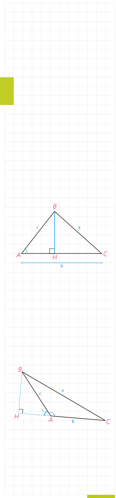

# درس دوم: قضیۀ کسینوس‌ها

می‌دانیم که در مثلث قائم‌الزاویۀ $ABC$ ($\widehat A=90^\circ$)، با داشتن طول‌های دو ضلع ($AB=c$) و ($AC=b$) می‌توانیم اندازۀ وتر مثلث ($BC=a$) را بر حسب $b$ و $c$ به‌دست آوریم: $a^2=b^2+c^2$. حال می‌بینیم که اگر $\widehat A$ مساوی $90^\circ$ هم نباشد، می‌توانیم این کار را انجام دهیم.

## فعالیت ۱

در مثلث $ABC$ ($\widehat A<90^\circ$)، ارتفاع $BH$ را رسم کرده‌ایم. با توجه به تعریف نسبت‌های مثلثاتی در مثلث‌های قائم‌الزاویه، جاهای خالی را پر کنید:

$$\cos A=\frac{\ldots}{\ldots}\Rightarrow AH=\ldots\times\ldots,\quad CH=b-AH=\ldots$$
$$\sin A=\frac{\ldots}{\ldots}\Rightarrow BH=\ldots\times\ldots$$
$$\triangle BHC:\ BC^2=BH^2+CH^2\Rightarrow a^2=(\ldots)^2+(\ldots)^2$$

حال به کمک اتحادهای جبری و اتحاد مثلثاتی $\sin^2A+\cos^2A=1$، نشان دهید: $a^2=b^2+c^2-2bc\cos A$.

اکنون در مثلث $ABC$ ($\widehat A>90^\circ$) ارتفاع $BH$ را در بیرون مثلث رسم می‌کنیم. اگر $\widehat A_1$ زاویۀ خارجی رأس $A$ باشد با توجه به اینکه $\widehat A_1=180^\circ-\widehat A$ داریم: $\sin A_1=\ldots$ و $\cos A_1=\ldots$ و در مثلث $ABH$ نیز با توجه به تعریف نسبت‌های مثلثاتی می‌توان نوشت:

$$\cos A_1=\frac{\ldots}{\ldots},\quad\sin A_1=\frac{\ldots}{\ldots}\Rightarrow AH=\ldots\times\ldots$$
$$BH=\ldots\times\ldots,\quad CH=b+AH=\ldots$$
$$\triangle BHC:\ BC^2=BH^2+CH^2\Rightarrow a^2=(\ldots)^2+(\ldots)^2$$

