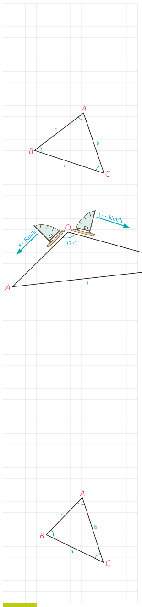

و با ساده کردن عبارت‌ها نشان دهید: $a^2=b^2+c^2-2bc\cos A$.

**سؤال:** در حالتی که زاویۀ $A$ قائمه باشد، این رابطه به چه صورت در می‌آید؟

**قضیۀ کسینوس‌ها:** در هر مثلث، مربع اندازۀ هر ضلع برابر است با مجموع مربع‌های اندازه‌های دو ضلع دیگر، منهای دو برابر حاصل‌ضرب اندازۀ آن دو ضلع در کسینوس زاویۀ بین آنها:

$$a^2=b^2+c^2-2bc\cos A,\quad b^2=\ldots+\ldots-\ldots,\quad c^2=\ldots+\ldots-\ldots$$

**مثال:** دو قایق از یک نقطه در دریاچه‌ای با سرعت‌های $60\,\mathrm{km/h}$ و $100\,\mathrm{km/h}$ و با زاویۀ $120^\circ$ از هم دور می‌شوند. نیم ساعت بعد دو قایق در چه فاصله‌ای از یکدیگر هستند؟

**حل:** با توجه به نقطۀ شروع دو قایق و سرعت‌های ثابت، نیم ساعت بعد، مسافت طی شده توسط هر قایق محاسبه می‌شود:

$$OA=60\times0.5=30,\qquad OB=100\times0.5=50$$

حال به کمک قضیۀ کسینوس‌ها می‌نویسیم:

$$AB^2=OA^2+OB^2-2OA\cdot OB\cos120^\circ,\quad\cos120^\circ=-\frac12$$
$$AB^2=900+2500-2\times30\times50\left(-\frac12\right)=4900\Rightarrow AB=70\,\mathrm{km}$$

## کار در کلاس

در مثلث $ABC$، $AB=2\sqrt2$ و $AC=\sqrt6+\sqrt2$ و $\widehat A=60^\circ$.

۱- طول ضلع $BC$ را به کمک قضیۀ کسینوس‌ها به‌دست آورید.

$$BC^2=\ldots^2+\ldots^2-2\times\ldots\times\ldots\times\ldots\Rightarrow$$
$$BC^2=\ldots+\ldots-\ldots\Rightarrow BC^2=\ldots,\quad BC=\ldots$$

