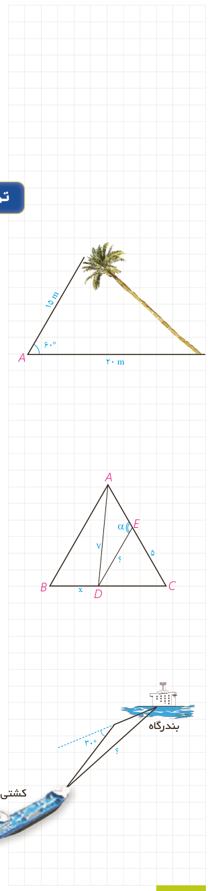

۲- اندازۀ $\widehat C$ را به کمک قضیۀ سینوس‌ها به‌دست آورید و از آنجا اندازۀ $\widehat B$ را هم بیابید.

$$\frac c{\sin C}=\frac a{\ldots}\Rightarrow\frac{2\sqrt2}{\sin C}=\frac{2\sqrt3}{\sin60^\circ}\Rightarrow\sin C=\ldots,\quad\widehat C=\ldots$$
$$\widehat B=180^\circ-(\widehat A+\widehat C)=\ldots$$

## تمرین

۱- یک درخت کج از نقطۀ $A$ روی زمین، که در فاصلۀ ۱۵ متری از نوک درخت است به زاویۀ $60^\circ$ دیده می‌شود. اگر فاصلۀ $A$ تا پای درخت ۲۰ متر باشد، مطلوب است:

الف) طول درخت
ب) سینوس زاویه‌ای که درخت با سطح زمین می‌سازد.
پ) فاصلۀ نوک درخت از زمین

۲- در مثلث متساوی‌الاضلاع $ABC$ به ضلع ۸ واحد، نقطۀ $D$، که به فاصلۀ ۷ واحد از رأس $A$ قرار دارد از $B$ و $C$ چه فاصله‌ای دارد؟ ($CD>BD$) نقطۀ $E$، که به فاصلۀ ۵ واحد از $C$ قرار دارد از $D$ به چه فاصله‌ای است؟ اندازۀ زاویۀ $AED$ چند درجه است؟

۳- یک کشتی از یک نقطه با سرعت ۶۰ کیلومتر در ساعت در یک جهت در حرکت است و یک ساعت بعد با $30^\circ$ انحراف به راست با سرعت ۴۰ کیلومتر در ساعت به حرکت خود ادامه می‌دهد و یک ساعت و نیم پس از آغاز حرکتش در یک بندرگاه پهلو می‌گیرد. فاصلۀ بندرگاه از مبدأ حرکت کشتی چند کیلومتر است؟

